# Лекция 12. TileSet и создание уровня

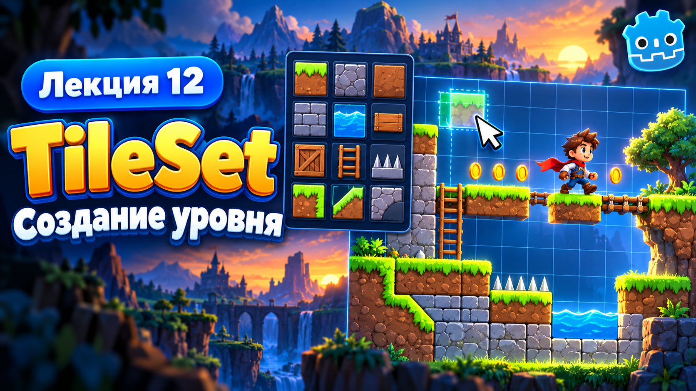

На прошлом занятии мы создали героя и построили тренировочный маршрут из отдельных платформ. Сегодня продолжим работу над тем же проектом и начнём превращать его в настоящий игровой уровень.

Вместо размещения каждой платформы вручную мы научимся рисовать землю, стены и платформы с помощью тайлов.

На этом занятии мы:

- подготовим изображение с тайлами;
- создадим `TileSet`;
- добавим `TileMapLayer`;
- нарисуем первую часть уровня;
- настроим коллизии земли;
- разделим карту на несколько слоёв;
- проверим взаимодействие персонажа и физических объектов с новым игровым окружением.

Каждый новый инструмент сразу применим при создании нашего платформера.

---

## Подготавливаем тайлы и создаём TileMapLayer

На прошлом занятии мы создавали платформы с помощью `StaticBody2D`. Для каждой платформы приходилось отдельно настраивать изображение, размеры и коллизию. Но что, если нам понадобится построить большой уровень с землёй, стенами, лестницами и десятками платформ?

Для этого в Godot существует специальный инструмент - **TileMapLayer**. Он позволяет создавать игровые уровни из небольших изображений, размещая их на сетке. Такие изображения называются **тайлами (Tiles)**.

Вместо того чтобы создавать каждую платформу отдельно, мы сможем буквально рисовать наш уровень.

**1. Подготавливаем изображения**

Для создания уровня нам понадобится специальное изображение, содержащее набор тайлов. Создайте в проекте новую папку:

`assets/tiles`

Перенесите в неё подготовленный файл `tilemap_packed.png`.

В результате структура файлов будет выглядеть следующим образом:

```text
assets/
└── tiles/
    └── tilemap_packed.png
```

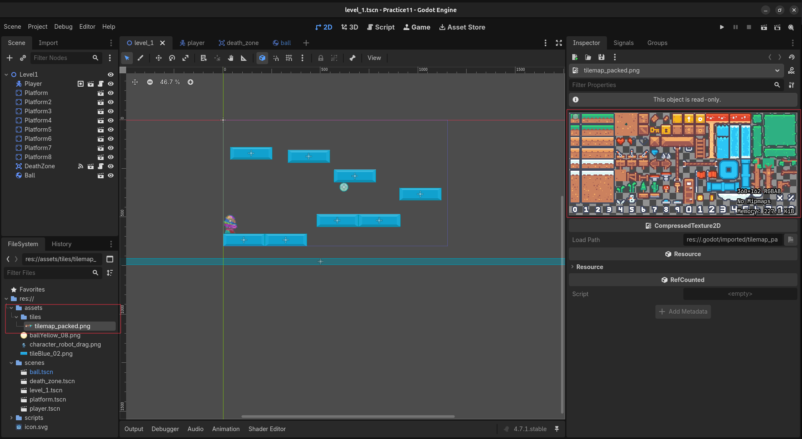

Обратите внимание, что изображение состоит из множества маленьких элементов. Здесь находятся разные варианты земли, краёв платформ и других деталей. Каждый такой элемент называется **тайлом (Tile)**, а изображение, объединяющее все тайлы, - **листом тайлов (Tilesheet)**. На основе этого изображения мы создадим ресурс **TileSet** для работы с тайлами в Godot.

В нашем случае размер изображения одного тайла составляет `16 × 16` пикселей. Между изображениями в атласе есть дополнительные отступы.

**2. Настраиваем отображение пиксельной графики**

При увеличении маленьких изображений Godot может сглаживать их края. Для пиксельной графики такое сглаживание нежелательно, поэтому изменим настройки проекта.

Откройте:

`Project → Project Settings → General`

Найдите раздел:

`Rendering → Textures → Canvas Textures`

Измените параметр:

`Default Texture Filter → Nearest`

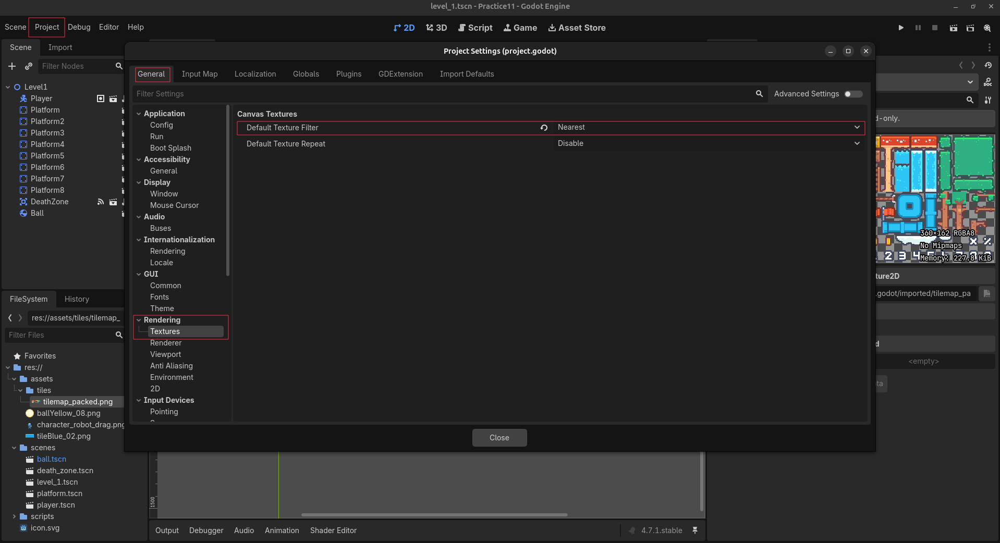

Теперь при увеличении изображения пиксели будут оставаться чёткими, а не размытыми.

**3. Добавляем TileMapLayer**

Вернитесь к нашей сцене `Level1`. Старые платформы пока не удаляйте. Они пригодятся для сравнения двух способов создания уровня. Выберите корневой узел `Level1` и нажмите кнопку `+` для добавления нового узла. В поиске введите: `TileMapLayer`

Выберите найденный узел и нажмите `Create`.

Переименуйте его в `Ground`.

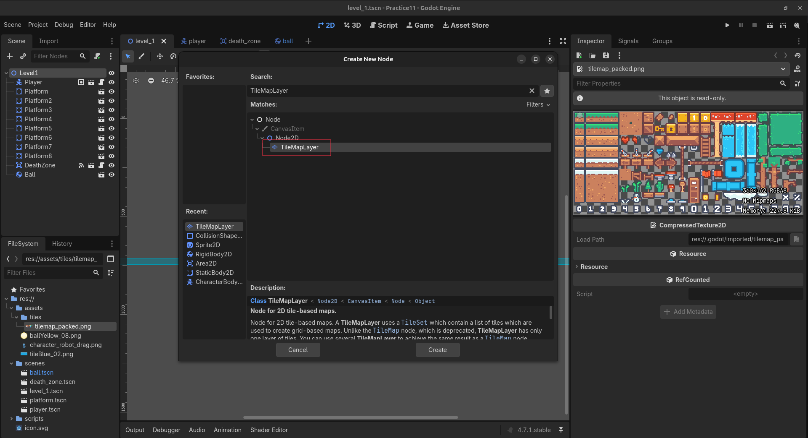

Теперь структура сцены будет выглядеть примерно так:

```text
Level1 (Node2D)
├── Ground (TileMapLayer)
├── Platform
├── Platform
├── Player
├── Ball
└── DeathZone
```

Мы назвали новый узел `Ground`, поскольку именно здесь будем размещать землю и обычные неподвижные платформы. **TileMapLayer** - это слой, на котором можно рисовать карту с помощью заранее подготовленных тайлов. Однако сейчас наш слой пустой. Прежде чем рисовать, необходимо указать, какие изображения мы будем использовать.

**4. Создаём TileSet**

Выберите узел `Ground` и найдите в панели `Inspector` свойство:

`Tile Set`

Нажмите на пустое поле рядом с ним и выберите:

`New TileSet`

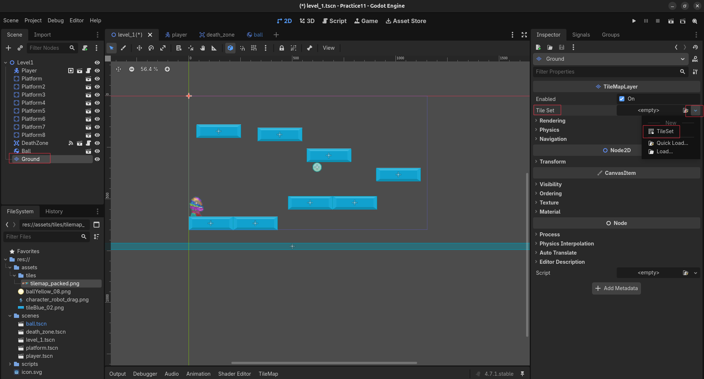

Мы создали новый ресурс `TileSet`.

Здесь важно понимать разницу между двумя инструментами:

- **TileSet** - хранит набор тайлов и их свойства.
- **TileMapLayer** - позволяет размещать эти тайлы на игровой карте.

Другими словами, `TileSet` - это набор строительных блоков, а `TileMapLayer` - место, где мы из них строим уровень.

Теперь необходимо указать размер наших строительных блоков. Нажмите на созданный ресурс `TileSet` в панели `Inspector`, чтобы открыть его настройки. Найдите параметр `Tile Size` и установите:

```text
Tile Size
X: 16
Y: 16
```

Это означает, что одна клетка нашей будущей карты будет иметь размер `16 × 16` пикселей. Размер должен соответствовать изображениям, которые мы собираемся использовать.

**5. Добавляем изображение в TileSet**

Теперь необходимо связать наш `TileSet` с подготовленным изображением. В нижней части редактора Godot найдите вкладку `TileSet` и откройте её. В панели `FileSystem` найдите файл:

`assets/tiles/tilemap_packed.png`

Перетащите его мышкой в область источников на панели `TileSet`.

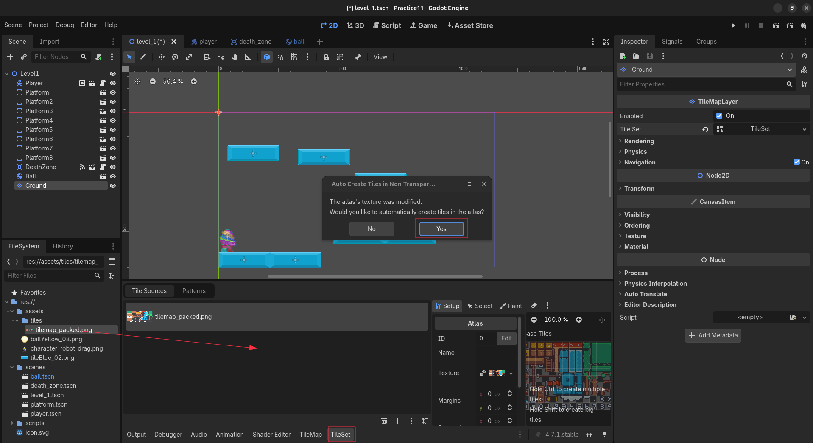

Godot предложит автоматически создать тайлы на основе изображения.

Пока выберите `No`, чтобы сначала настроить размеры и отступы.

Выберите созданный атлас и установите его настройки:

```text
Texture Region Size: 16 × 16
Margins: 1 × 1
Separation: 2 × 2
```

После настройки откройте меню с тремя точками в редакторе атласа и выберите `Create Tiles in Non-Transparent Texture Regions`.

Теперь изображение разделится на отдельные элементы, которые можно использовать при построении уровня. Такой способ хранения тайлов в Godot называется **атласом (Atlas)**.

Здесь:

- `Texture Region Size` - размер одного изображения в атласе.
- `Margins` - отступы от краёв общего изображения.
- `Separation` - расстояние между соседними тайлами.

Если исходное изображение содержит тайлы без промежутков, значения `Margins` и `Separation` должны быть равны нулю.

**6. Рисуем первую платформу**

Перед тем как начинать рисовать первую платформу, удалим уже существующие.

### Увеличиваем размер тайлов

Сейчас каждый тайл имеет размер `16 × 16` пикселей. Для нашего платформера такая земля может оказаться слишком маленькой по сравнению с персонажем.

Мы можем увеличить все тайлы, не изменяя исходное изображение. Для этого выберите узел `Ground` в дереве сцены. В панели `Inspector` найдите раздел:

`Transform → Scale`

По умолчанию установлены значения:

```text
Scale
X: 1
Y: 1
```

Измените их на:

```text
Scale
X: 2
Y: 2
```

Теперь все тайлы на слое `Ground` станут в два раза больше.

Например:

- `Scale (1, 1)` - размер тайла 16 × 16 пикселей.
- `Scale (2, 2)` - размер тайла 32 × 32 пикселя.
- `Scale (3, 3)` - размер тайла 48 × 48 пикселей.

**Важно:** свойство `Scale` увеличивает весь слой `Ground`, а не отдельный тайл. Поэтому все платформы, которые мы нарисовали или нарисуем на этом слое, будут иметь одинаковый масштаб.

Не путайте `Scale` с параметром `Tile Size`. `Tile Size` определяет размер клетки карты, а `Scale` изменяет масштаб всего слоя.

Поскольку ранее мы установили фильтр `Nearest`, пиксельная графика останется чёткой даже после увеличения.

### Рисуем первую платформу

Наш `TileSet` готов! Теперь попробуем использовать его для создания уровня. В нижней части Godot переключитесь с вкладки `TileSet` на вкладку `TileMap`. Здесь появятся все тайлы, которые мы добавили в предыдущем шаге.

Выберите подходящий тайл земли.

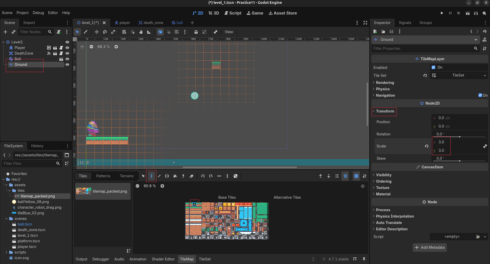

Переместите курсор в рабочую область сцены. Теперь, удерживая левую кнопку мыши, попробуйте нарисовать небольшую горизонтальную платформу. Вы заметите, что изображения автоматически размещаются по сетке.

### Продолжаем строить уровень

Теперь, когда размер земли нас устраивает, попробуйте самостоятельно:

1. Нарисовать горизонтальную поверхность из нескольких тайлов.
2. Добавить под ней ещё несколько рядов земли.
3. Создать небольшую платформу немного выше основной.
4. Использовать разные тайлы, чтобы сделать землю красивее.

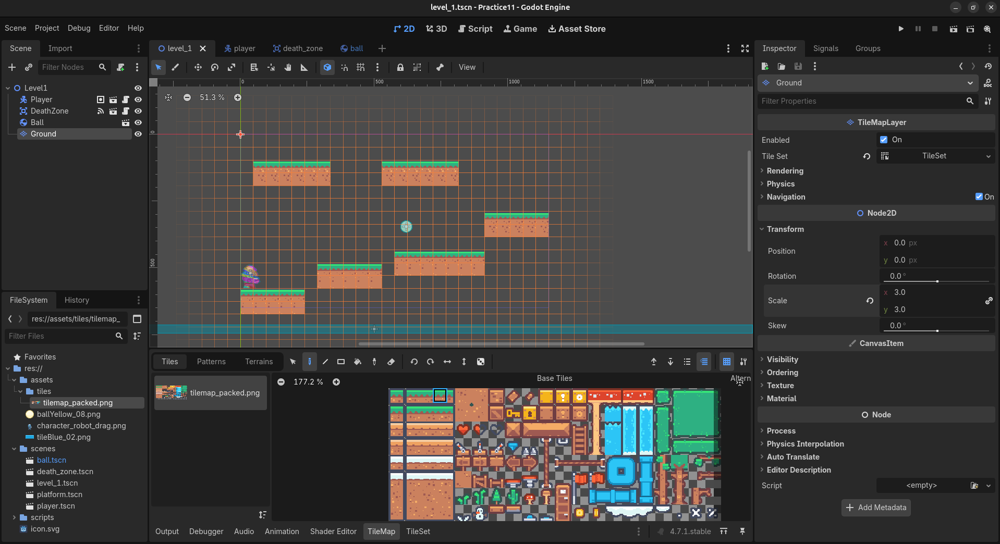

Обратите внимание, насколько быстрее мы создаём платформы по сравнению с предыдущим занятием. Нам больше не нужно добавлять отдельный `StaticBody2D` для каждого блока земли.

**7. Проверяем результат**

Теперь проверим, может ли наш персонаж взаимодействовать с нарисованной платформой. Расположите `Player` немного выше новой поверхности и запустите игру клавишей `F6`. Наш персонаж проваливается прямо сквозь землю!

Причина в том, что созданные тайлы пока являются обычными изображениями. Они отображаются на экране, но не имеют физических границ.

Персонаж не знает, что перед ним находится твёрдая поверхность.

Чтобы исправить это, необходимо добавить нашим тайлам **коллизии (Collision)**. Именно этим мы займёмся в следующем разделе.

## Настраиваем коллизии для тайлов

Мы научились рисовать землю и платформы с помощью `TileMapLayer`, но при запуске игры обнаружили проблему - персонаж проваливается сквозь них.

Это происходит потому, что наши тайлы пока являются обычными изображениями и не имеют физических границ.

На прошлом занятии мы решали эту проблему с помощью `CollisionShape2D`. Теперь научимся добавлять коллизии непосредственно к тайлам.

### Создаём физический слой

Для начала необходимо разрешить нашему `TileSet` использовать физические столкновения. Выберите узел `Ground` в дереве сцены.

В панели `Inspector` найдите свойство `Tile Set` и нажмите на созданный ранее ресурс `TileSet`, чтобы открыть его настройки.

Найдите раздел:

`Physics Layers`

Разверните его и нажмите кнопку `Add Element`.

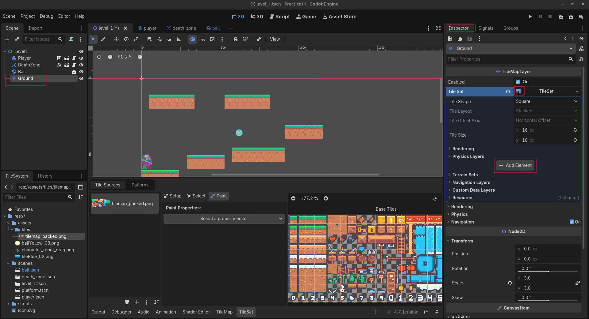

После этого появится новый физический слой с двумя основными параметрами:

- `Collision Layer` - определяет, на каком физическом слое находятся наши тайлы.
- `Collision Mask` - определяет, с какими физическими слоями они могут взаимодействовать.

Пока оставим стандартные значения:

```text
Collision Layer: 1
Collision Mask: 1
```

Это позволит земле взаимодействовать с персонажем и другими физическими объектами, использующими первый слой столкновений.

**Важно:** мы только разрешили использование коллизий в `TileSet`. Сами тайлы пока не получили физических границ.

В следующем шаге мы нарисуем коллизию для первого тайла земли.

---

### Добавляем коллизию первому тайлу

Теперь, когда физический слой создан, необходимо указать, какие именно тайлы будут иметь коллизию. Выберите узел `Ground` и откройте вкладку `TileSet` в нижней части редактора Godot.

Выберите наш атлас `tilemap_packed.png`.

В верхней части редактора находятся три инструмента:

- `Setup` - настройка атласа.
- `Select` - выбор и редактирование отдельных тайлов.
- `Paint` - применение свойств к тайлам.

Переключитесь на вкладку `Paint`.

В разделе `Paint Properties` откройте выпадающий список и выберите:

`Physics Layer 0`

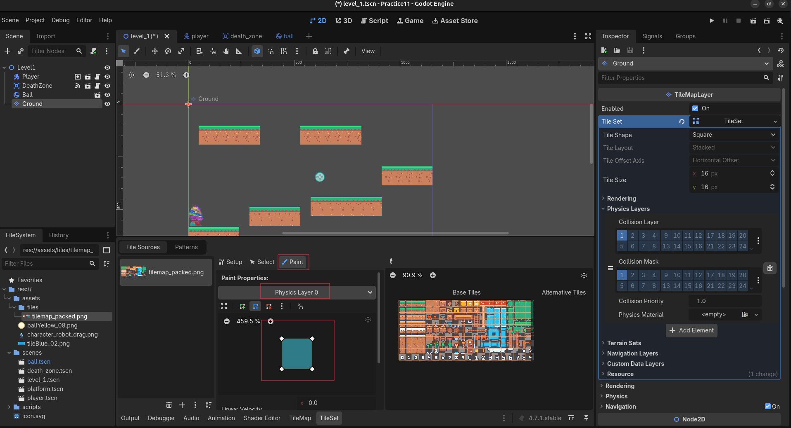

После этого появится редактор коллизий. В нём мы можем создавать физические границы для наших тайлов.

**Создаём форму коллизии**

Для начала используем обычный квадратный тайл земли.

В левой части редактора находится небольшая область для настройки формы коллизии, а справа - наш атлас с изображениями. Нам необходимо создать прямоугольную коллизию, которая будет занимать всю площадь тайла. Щёлкните по области редактирования коллизии, чтобы она получила фокус, и нажмите клавишу `F`. Godot создаст прямоугольную форму коллизии по размеру тайла. Если прямоугольник уже существует, дополнительно создавать его не нужно.

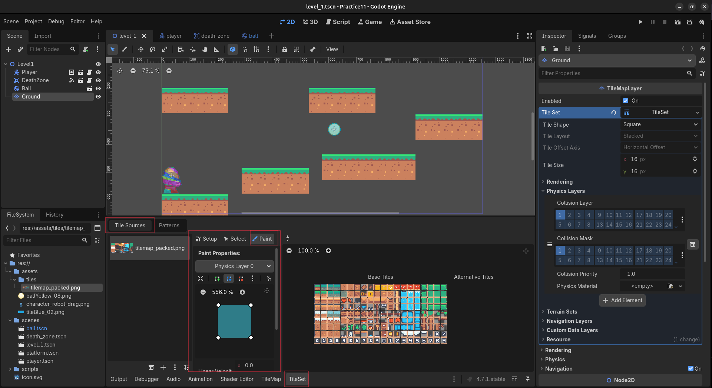

Обратите внимание на белые точки по углам прямоугольника.

Это вершины **полигона коллизии (Collision Polygon)**. Перемещая их мышкой, можно изменять форму столкновения.

Например, мы можем создать треугольную коллизию для наклонной поверхности или повторить сложный контур изображения.

Пока оставим обычный прямоугольник.

**Применяем коллизию к тайлу**

Теперь необходимо назначить созданную форму конкретному тайлу. В правой части редактора найдите обычный квадратный тайл земли и нажмите на него левой кнопкой мыши. Godot применит подготовленную коллизию к выбранному тайлу.

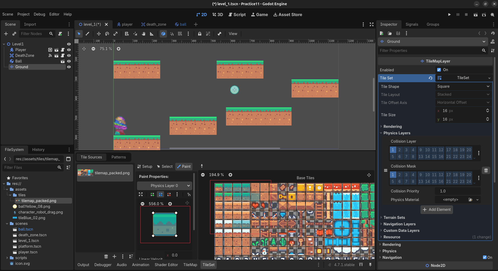

Теперь каждый раз, когда мы будем использовать этот тайл на карте, он будет иметь физическую границу.

**Важно:** коллизия сохраняется в ресурсе `TileSet`, поэтому не нужно создавать её заново для каждой копии одного и того же тайла.

Однако остальные виды земли пока не имеют коллизий. В следующем шаге мы научимся быстро добавлять одинаковые физические границы сразу нескольким тайлам.

### Добавляем коллизии остальным тайлам

Мы настроили коллизию для первого тайла земли. Теперь необходимо добавить физические границы остальным тайлам, которые будем использовать для создания уровня.

Оставаясь в режиме `Paint`, выберите `Physics Layer 0`.

С помощью подготовленной прямоугольной формы добавьте коллизии всем тайлам земли, камней и платформ.

Для этого достаточно нажимать на нужные тайлы левой кнопкой мыши. Можно также удерживать кнопку и проводить по нескольким тайлам подряд.

**Важно:** декоративным элементам, через которые персонаж должен свободно проходить, коллизии добавлять не нужно.

Теперь наши тайлы имеют физические границы. Вернёмся к сцене `Level1` и проверим, как персонаж взаимодействует с землёй.

### Проверяем столкновения с землёй

Мы добавили физические границы нашим тайлам. Теперь проверим, сможет ли персонаж взаимодействовать с нарисованным уровнем.

Вернитесь к сцене `Level1` и расположите персонажа `Player` немного выше поверхности земли.

Убедитесь, что под персонажем находятся именно тайлы нашего слоя `Ground`.

Запустите сцену клавишей `F6`.

Если всё настроено правильно, персонаж упадёт на землю и остановится, а не провалится сквозь неё.

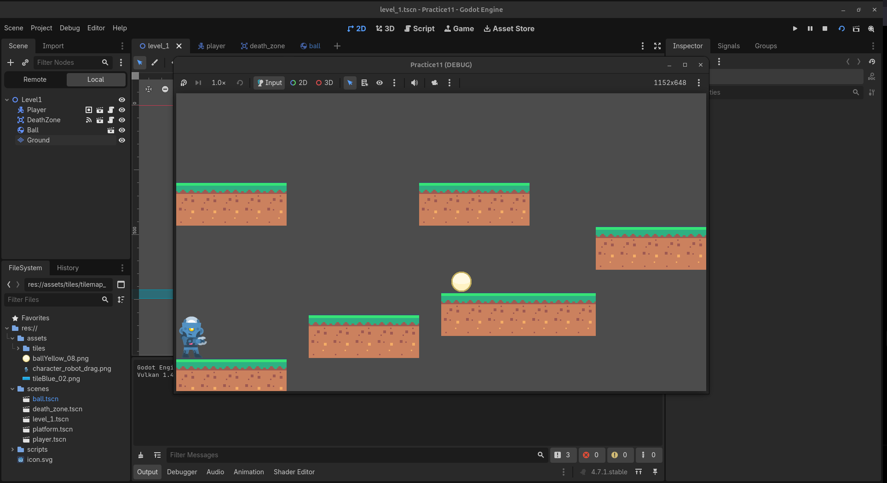

Попробуйте самостоятельно:

1. Пройтись по земле влево и вправо.
2. Подпрыгнуть и приземлиться обратно.
3. Запрыгнуть на платформу повыше.
4. Проверить, может ли персонаж проходить сквозь стены.

### Отображаем коллизии в игре

Иногда бывает сложно понять, почему персонаж сталкивается с невидимой преградой или проваливается сквозь платформу. Для поиска таких ошибок в Godot предусмотрен специальный инструмент. В верхнем меню редактора откройте:

`Debug → Visible Collision Shapes`

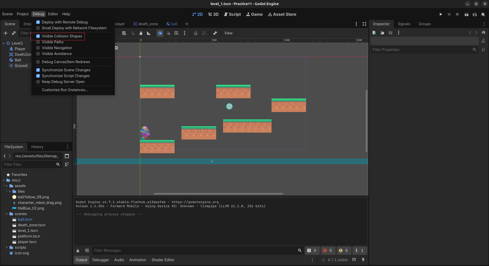

Теперь запустите сцену повторно. Во время игры Godot будет отображать физические границы объектов. Мы сможем увидеть коллизии персонажа и нарисованной земли.

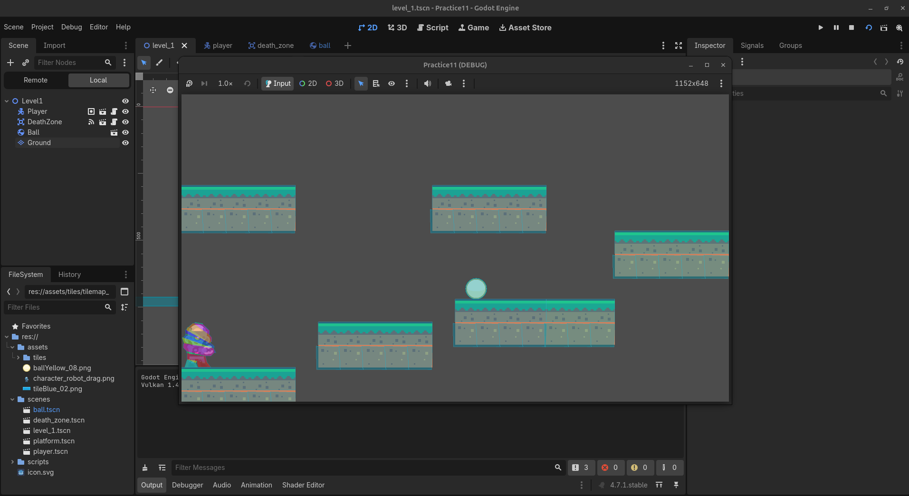

Обратите внимание, что границы коллизий должны соответствовать поверхностям, по которым передвигается персонаж.

Если персонаж проваливается через отдельные участки земли, проверьте, назначены ли коллизии всем использованным тайлам.

После проверки отключите `Visible Collision Shapes` через то же меню.

Теперь мы можем создавать полноценные игровые уровни, не добавляя отдельный `StaticBody2D` для каждого блока земли.

## Разделяем карту на несколько слоёв

Сейчас вся земля и платформы находятся на одном слое `Ground`. Но в полноценной игре нам понадобятся не только поверхности, по которым передвигается персонаж, но и различные декоративные элементы.

Например, мы можем добавить деревья, кусты, камни и красивый задний план. При этом некоторые объекты должны находиться позади персонажа, а другие - перед ним.

Для этого в Godot можно использовать несколько узлов `TileMapLayer`, каждый из которых будет отвечать за определённую часть уровня.

Мы создадим три слоя:

- `Background` - задний план нашего уровня.
- `Ground` - земля и платформы с коллизиями.
- `Decorations` - деревья, кусты и другие декоративные объекты.

### 1. Сохраняем наш TileSet

Прежде чем создавать новые слои, сохраним подготовленный `TileSet` как отдельный ресурс.

Это позволит использовать один набор тайлов на нескольких слоях и даже в других игровых уровнях.

Выберите узел `Ground` и найдите в панели `Inspector` свойство `Tile Set`.

Нажмите на стрелку рядом с ресурсом и выберите `Save As...`.

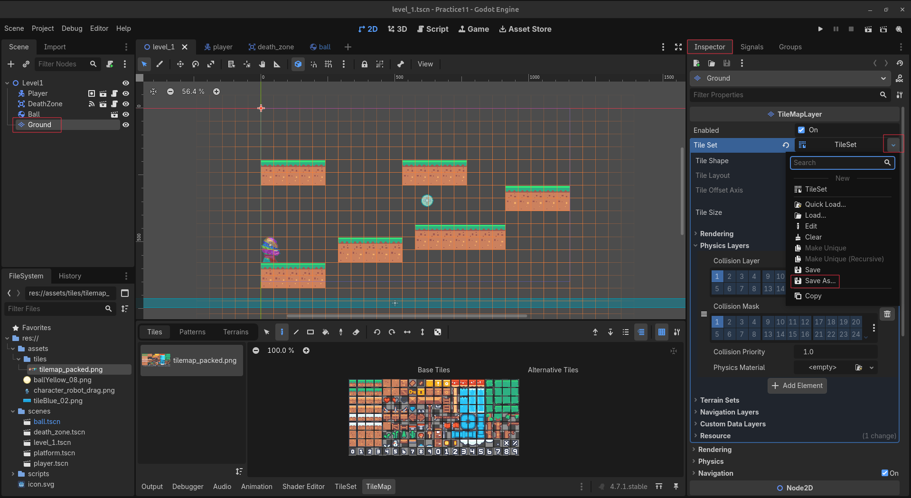

Сохраните ресурс в папку `assets/tiles` под названием:

`level_tileset.tres`

Теперь наш набор тайлов хранится в отдельном файле, который можно подключать к другим узлам `TileMapLayer`.

### 2. Создаём дополнительные слои

Выберите корневой узел `Level1` и добавьте новый `TileMapLayer`.

Назовите его `Background`.

Этот слой будет отвечать за изображения, которые находятся позади основного игрового уровня.

Выберите `Background` и найдите в `Inspector` свойство `Tile Set`. Пока подключите сохранённый ресурс `level_tileset.tres`. Немного позже мы заменим его отдельным набором тайлов для фона.

Установите следующие параметры:

```text
Transform → Scale
X: 2
Y: 2
Ordering → Z Index: -1
Physics → Collision Enabled: Off
```

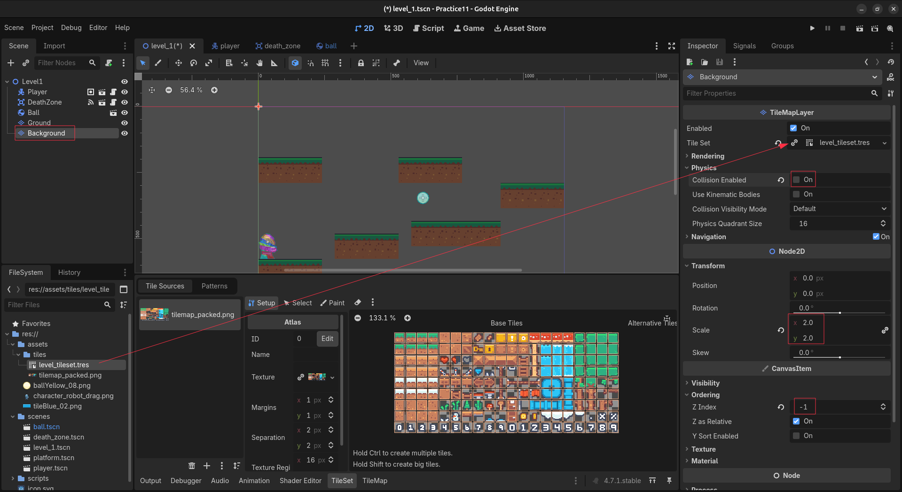

Обратите внимание на параметр `Z Index`. Он определяет порядок отображения объектов.

Чем больше значение `Z Index`, тем выше объект в порядке отрисовки: он отображается поверх объектов с меньшим значением.

Например:

- `Z Index: -1` - объект находится позади основного уровня.
- `Z Index: 0` - стандартный уровень отображения.
- `Z Index: 1` - объект отображается перед объектами с нулевым значением.

Также мы отключили `Collision Enabled`, поскольку наш фон не должен мешать передвижению персонажа.

Теперь добавьте ещё один узел `TileMapLayer` и назовите его `Decorations`.

Подключите к нему ресурс `level_tileset.tres` и установите:

```text
Transform → Scale
X: 2
Y: 2
Ordering → Z Index: 1
Physics → Collision Enabled: Off
```

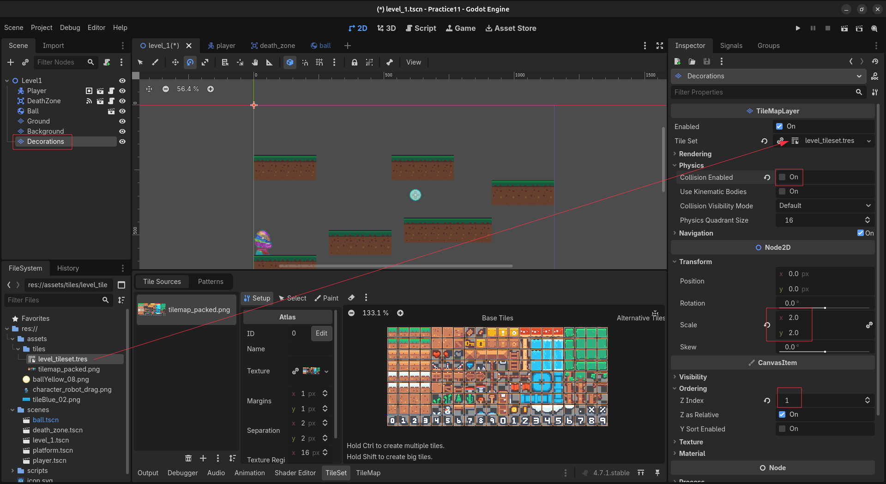

Теперь структура нашей сцены будет выглядеть примерно так:

```text
Level1 (Node2D)
├── Player
├── DeathZone
├── Ball
├── Ground (TileMapLayer)
├── Background (TileMapLayer)
└── Decorations (TileMapLayer)
```

Мы разделили игровую карту на три независимых слоя. Теперь каждый из них можно редактировать отдельно.

### 3. Подготавливаем изображение для заднего плана

Для создания красивого заднего плана воспользуемся новым изображением с несколькими вариантами окружения.

Добавьте файл `tilemap-backgrounds.png` в папку:

`assets/tiles`

В результате структура папки будет выглядеть следующим образом:

```text
assets/
└── tiles/
    ├── level_tileset.tres
    ├── tilemap_packed.png
    └── tilemap-backgrounds.png
```

В новом изображении находятся три варианта окружения:

- Снежный пейзаж.
- Пустынный пейзаж.
- Зелёный пейзаж с деревьями.

Для нашего платформера выберем зелёный вариант, поскольку он хорошо сочетается с уже созданной землёй.

**Создаём отдельный TileSet**

Выберите узел `Background`. В панели `Inspector` найдите свойство `Tile Set` и замените подключённый ресурс на `New TileSet`. Мы создаём отдельный `TileSet`, поскольку изображения фона имеют другой размер и не должны изменять настройки основного набора тайлов.

Откройте созданный ресурс и установите:

```text
Tile Size
X: 24
Y: 24
```

Теперь откройте вкладку `TileSet` в нижней части редактора. Перетащите изображение `tilemap-backgrounds.png` из панели `FileSystem` в область источников. Если Godot предложит автоматически создать тайлы, выберите `No`. Сначала необходимо правильно настроить размеры изображений. Переключитесь в режим `Setup` и установите следующие параметры:

```text
Margins:
X: 0
Y: 0
Separation:
X: 1
Y: 1
Texture Region Size:
X: 24
Y: 24
```

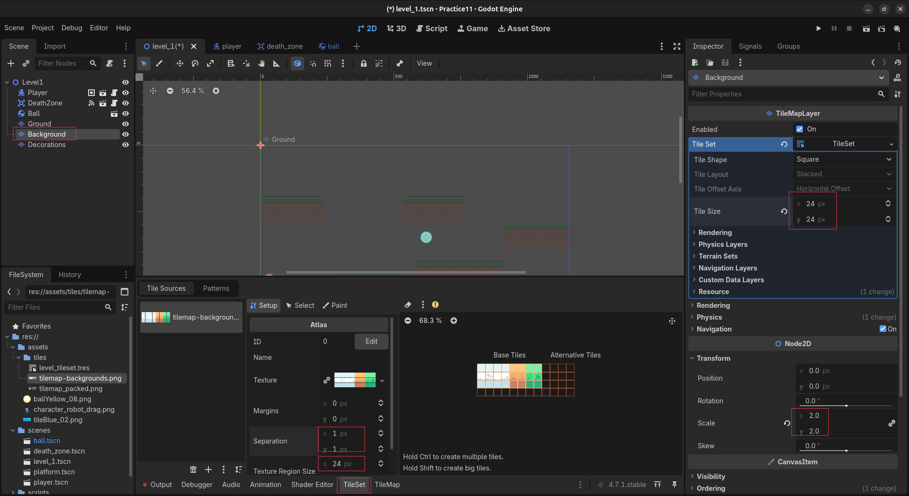

Обратите внимание, что размер тайлов здесь отличается от размера тайлов земли.

- `Ground` использует тайлы размером `16 × 16`.
- `Background` использует тайлы размером `24 × 24`.

Это нормально! Разные слои могут использовать разные размеры клеток.

После настройки атласа откройте меню с тремя точками в редакторе `TileSet` и выберите:

`Create Tiles in Non-Transparent Texture Regions`

Godot создаст тайлы на основе подготовленного изображения.

### 4. Сохраняем TileSet для фона

Теперь сохраним новый набор тайлов как отдельный ресурс. Выберите `Background` и найдите в `Inspector` свойство `Tile Set`. Нажмите на стрелку рядом с созданным ресурсом и выберите `Save As...`.

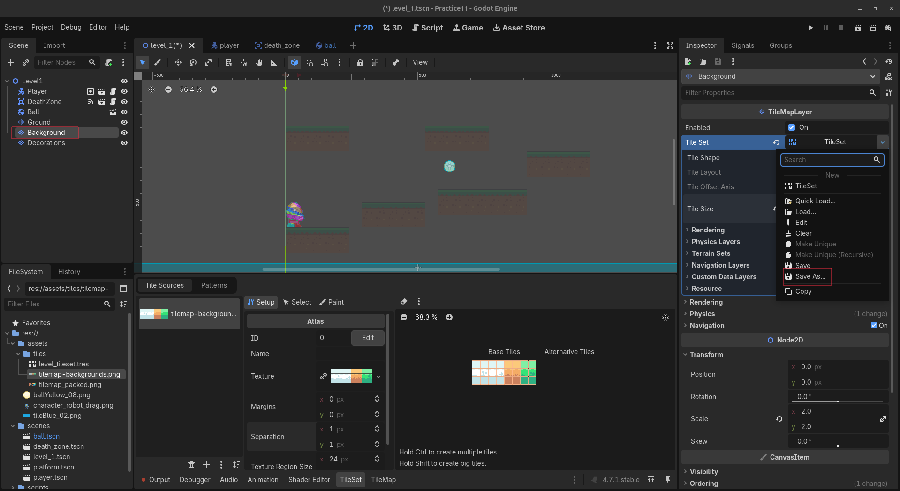

Сохраните ресурс под названием:

`background_tileset.tres`

В результате у нас будет два независимых набора тайлов:

```text
assets/
└── tiles/
    ├── level_tileset.tres
    ├── background_tileset.tres
    ├── tilemap_packed.png
    └── tilemap-backgrounds.png
```

Первый используется для земли и декораций, а второй - для заднего плана.

### 5. Рисуем задний план

Теперь попробуем создать настоящий фон для нашего платформера. Выберите узел `Background` и переключитесь на вкладку `TileMap` в нижней части редактора. Вы увидите подготовленный набор тайлов `tilemap-backgrounds.png`. Найдите зелёный вариант окружения с деревьями.

**Выделяем несколько тайлов одновременно**

Вместо того чтобы размещать каждый элемент отдельно, мы можем выделить сразу несколько соседних тайлов.

Для этого:

1. Наведите курсор на первый тайл зелёного фона.
2. Зажмите левую кнопку мыши.
3. Выделите прямоугольную область из нескольких тайлов.
4. Отпустите кнопку мыши.

Теперь выбранный фрагмент можно целиком размещать на игровой карте. Переместите курсор в рабочую область сцены и разместите изображение позади наших платформ. Повторите действие несколько раз, чтобы заполнить задний план. При необходимости используйте отдельные тайлы, чтобы соединить фрагменты изображения. Поскольку у `Background` установлен `Z Index: -1`, персонаж и земля будут отображаться поверх нашего фона.

Запустите игру и посмотрите на результат.

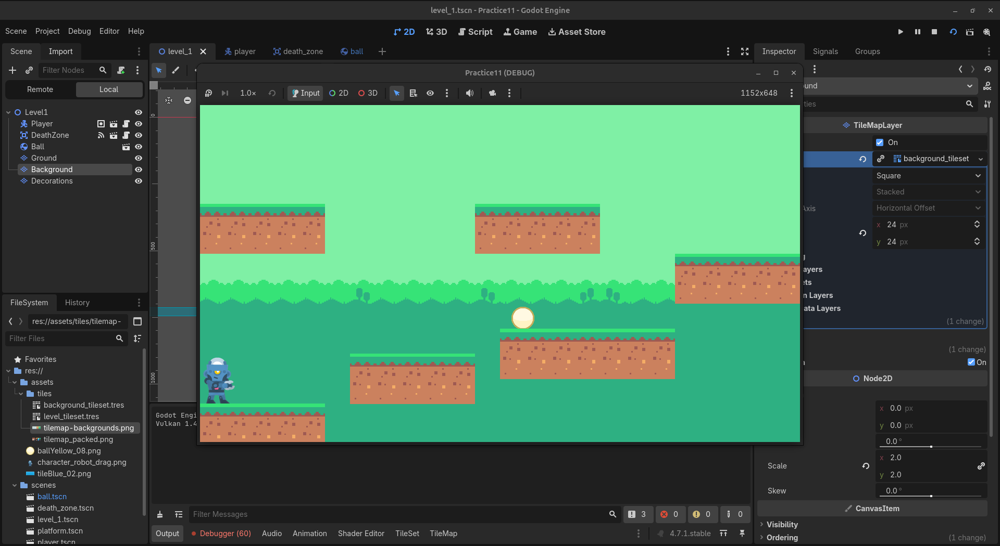

Теперь наш платформер выглядит гораздо интереснее!

Вместо пустого пространства мы получили полноценное игровое окружение с зелёным небом, деревьями и кустами.

### 6. Добавляем декоративные элементы

Теперь воспользуемся третьим слоем - `Decorations`.

Выберите его в дереве сцены и откройте вкладку `TileMap`.

Поскольку мы подключили к этому слою `level_tileset.tres`, здесь будут доступны изображения из нашего основного атласа.

Найдите декоративные элементы, например:

- Деревья.
- Кусты.
- Грибы.
- Небольшие камни.
- Другие элементы окружения.

Разместите несколько декоративных объектов на игровых платформах. Попробуйте использовать разные размеры деревьев и распределить объекты по уровню так, чтобы он выглядел интереснее.

**Важно:** мы отключили коллизии у слоя `Decorations`. Поэтому персонаж сможет свободно проходить через декоративные элементы.

При этом коллизии земли на слое `Ground` продолжат работать как раньше.

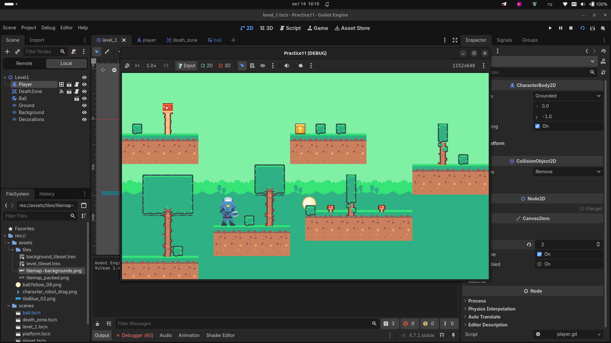

Теперь наш уровень состоит из нескольких независимых частей:

- `Background` создаёт окружающий пейзаж.
- `Ground` отвечает за землю и физические столкновения.
- `Decorations` позволяет украшать уровень, не изменяя его физику.

### 7. Экспериментируем с Z Index

Мы уже познакомились с параметром `Z Index`, но теперь посмотрим, как он работает на практике.

На нашем уровне используются следующие значения:

```text
Background: -1
Ground: 0
Decorations: 1
Player: 2
```

Сейчас персонаж находится перед декоративными элементами, поскольку его `Z Index` больше.

Попробуем это изменить.

1. Выберите узел `Decorations`.
2. Найдите `Ordering → Z Index`.
3. Измените значение с `1` на `3`.
4. Запустите игру.
5. Подведите персонажа к дереву или другому декоративному объекту.

Теперь декорации с `Z Index: 3` будут отображаться перед персонажем, у которого `Z Index: 2`.

Остановите игру и верните значение:

`Decorations → Z Index: 1`

Таким образом, с помощью `Z Index` мы можем управлять тем, какие объекты находятся на переднем плане, а какие - на заднем.

### 8. Проверяем результат

Запустите игру и попробуйте пройти созданный уровень.

Убедитесь, что:

1. Персонаж свободно передвигается по земле и платформам.
2. Фон отображается позади игровых объектов.
3. Декоративные элементы не мешают передвижению персонажа.
4. Коллизии земли продолжают работать.
5. Все изображения правильно отображаются относительно друг друга.

Теперь мы научились разделять игровой уровень на несколько слоёв, использовать разные `TileSet` и управлять порядком отображения объектов.

Благодаря этому мы можем создавать гораздо более красивые и разнообразные игровые уровни, не усложняя их физику.

---

## Практика

Доработайте собственный уровень платформера с помощью `TileSet` и `TileMapLayer`:

- замените старые платформы на тайлы из `TileSet`;
- расширьте игровой маршрут, добавив минимум 8 платформ разной высоты;
- создайте несколько пропастей и сложных участков для прыжков;
- оформите задний план с помощью слоя `Background`;
- добавьте деревья, кусты и другие элементы на слой `Decorations`;
- настройте коллизии земли и проверьте работу `DeathZone`;
- добавьте несколько физических объектов на платформы;
- пройдите созданный уровень от начала до конца.

Убедитесь, что персонаж не проваливается сквозь платформы, декоративные элементы не мешают движению, а весь маршрут можно пройти.

---

## Домашнее задание

Продолжите работу над проектом, который вы создали в домашнем задании к лекции 11. Теперь ваша задача - превратить тренировочный маршрут в полноценный игровой уровень с помощью `TileSet` и `TileMapLayer`.

### Обязательная часть

- замените старые платформы `StaticBody2D` на тайлы с помощью `TileMapLayer`;
- сохраните маршрут минимум из восьми платформ разной высоты;
- настройте коллизии для всех тайлов земли;
- создайте три слоя: `Background`, `Ground` и `Decorations`;
- добавьте задний план, который будет покрывать весь игровой маршрут;
- разместите минимум десять декоративных элементов;
- настройте `Z Index` для правильного отображения объектов;
- сохраните два физических мяча и настройте их взаимодействие с новой поверхностью;
- проверьте работу `DeathZone` и перезапуск уровня.

### Дополнительное задание

Создайте на уровне две разные природные зоны, например лес и пустыню.

Используйте разные тайлы для оформления земли, фона и декоративных элементов. Сделайте плавный переход между зонами.

Проверьте свой уровень несколько раз. Персонаж должен проходить весь маршрут, физические объекты - правильно взаимодействовать с поверхностями, а декоративные элементы - не мешать движению.

---

## Итоги занятия

Сегодня мы научились создавать игровые уровни с помощью `TileSet` и `TileMapLayer`.

На занятии мы:

- познакомились с тайлами и научились создавать `TileSet`;
- настроили атлас и размеры тайлов;
- научились рисовать землю и платформы с помощью `TileMapLayer`;
- добавили коллизии тайлам и проверили столкновения;
- разделили игровой уровень на слои `Background`, `Ground` и `Decorations`;
- научились использовать разные `TileSet` в одной сцене;
- настроили порядок отображения объектов с помощью `Z Index`;
- добавили задний план и декоративные элементы.

Теперь мы можем создавать большие игровые уровни, не размещая каждую платформу вручную.

**На следующем занятии** познакомимся с камерой и границами игрового мира. Научимся перемещать камеру вслед за персонажем и ограничивать область её движения, чтобы игрок не видел пространство за пределами уровня.
