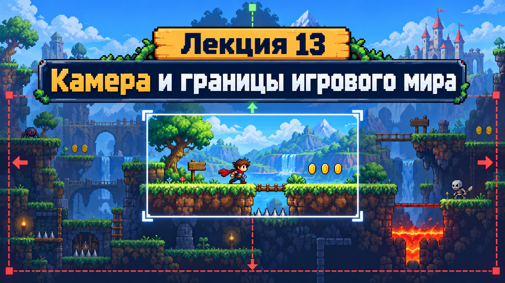
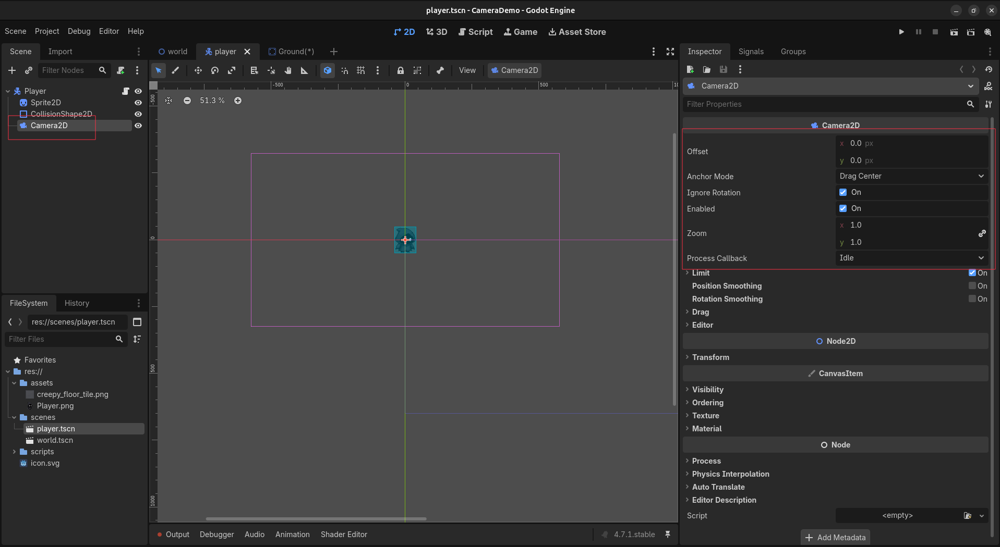
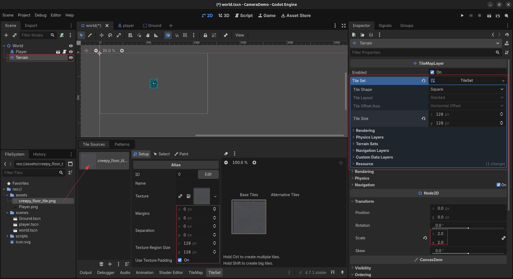
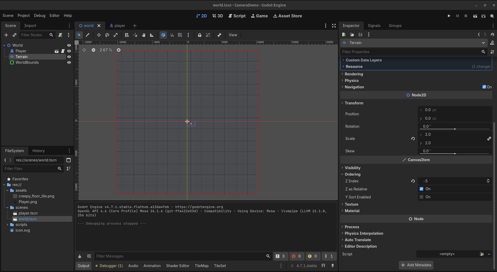
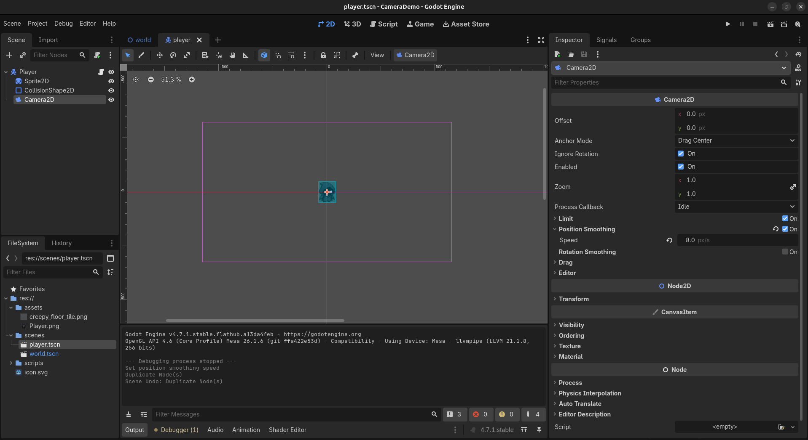
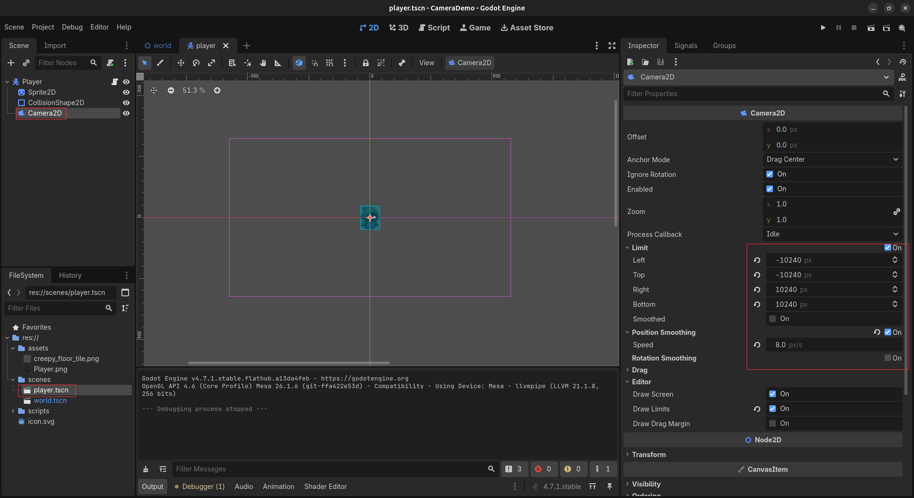
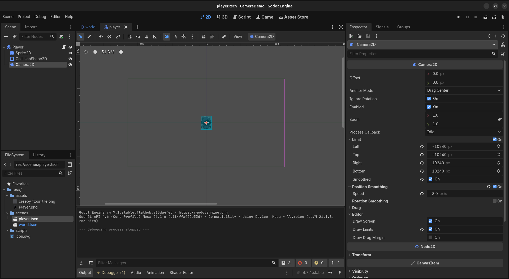
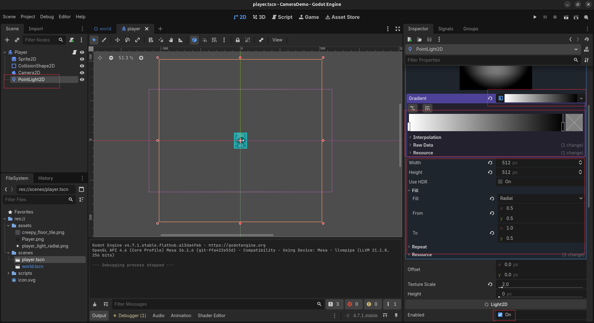
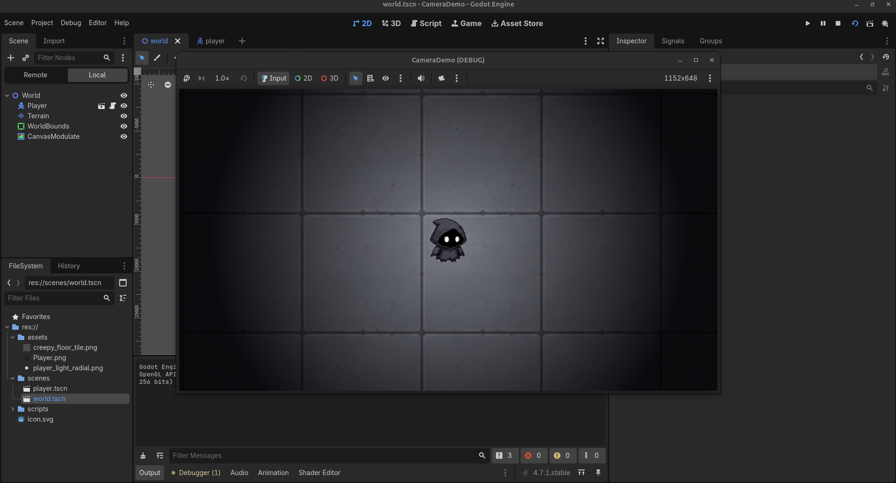

# Лекция 13. Камера и границы игрового мира



На прошлом занятии мы научились создавать игровые уровни с помощью `TileSet` и `TileMapLayer`, добавлять коллизии и разделять игровую карту на несколько слоёв.

Но что произойдёт, если наш игровой мир окажется значительно больше экрана?

Персонаж сможет продолжать движение, однако мы перестанем его видеть. Чтобы решить эту проблему, в Godot существует специальный узел - **Camera2D**.

На этом занятии мы создадим отдельный проект с огромным квадратным миром, по которому персонаж сможет свободно перемещаться вверх, вниз, влево и вправо.

Мы научимся:

- создавать персонажа со свободным перемещением;
- использовать `Input.get_vector()` для движения в четырёх направлениях;
- создавать большой игровой мир с помощью `TileMapLayer`;
- использовать `Camera2D` и перемещать камеру вслед за персонажем;
- изменять масштаб изображения с помощью `Zoom`;
- настраивать плавное движение камеры;
- ограничивать область обзора границами игрового мира;
- управлять поведением камеры возле краёв карты.

Каждый новый инструмент будем сразу применять на практике.

---

## Подготавливаем проект

Начнём с создания нового проекта, в котором будем изучать работу камеры.

### Создаём новый проект

Откройте Godot и создайте проект со следующими параметрами:

```text
Project Name: CameraDemo
Renderer: Compatibility
```

После создания подготовьте папки:

```text
assets/
scenes/
scripts/
```

Здесь будем хранить изображения, игровые сцены и скрипты.

### Создаём персонажа

Добавьте подготовленное изображение персонажа в проект:

```text
assets/creepy_player.png
```

Создайте новую сцену с корневым узлом `CharacterBody2D` и назовите его `Player`.

Добавьте два дочерних узла:

```text
Player (CharacterBody2D)
├── Sprite2D
└── CollisionShape2D
```

Выберите `Sprite2D` и добавьте `creepy_player.png` в свойство `Texture`.

При необходимости уменьшите изображение через `Transform → Scale`. Для пиксельной графики можно установить `Texture Filter → Nearest`.

Выберите `CollisionShape2D`, создайте `New RectangleShape2D` и подгоните форму под персонажа.

Сохраните сцену:

```text
scenes/player.tscn
```

---

## Настраиваем свободное движение Player

Теперь добавим управление персонажем. Он сможет свободно перемещаться в четырёх направлениях без гравитации.

### Настраиваем Input Map

Откройте:

`Project → Project Settings → Input Map`

Создайте четыре действия:

| Action         | Клавиши |
| -------------- | -------------- |
| `move_left`  | A, ←          |
| `move_right` | D, →          |
| `move_up`    | W, ↑          |
| `move_down`  | S, ↓          |

Для буквенных клавиш используйте `Physical Keycode`.

### Создаём скрипт Player

Выберите корневой узел `Player` и добавьте новый скрипт:

```text
scripts/player.gd
```

Напишем код свободного перемещения:

```gdscript
extends CharacterBody2D

const SPEED = 600.0


func _physics_process(_delta):
    var direction = Input.get_vector(
        "move_left",
        "move_right",
        "move_up",
        "move_down"
    )

    velocity = direction * SPEED

    move_and_slide()
```

Обратите внимание на метод:

```gdscript
Input.get_vector()
```

Он позволяет получать направление движения сразу по двум осям:

- `X` - движение влево и вправо;
- `Y` - движение вверх и вниз.

Метод возвращает `Vector2` - вектор, который содержит два значения: `X` и `Y`.

Например:

```text
Влево:    (-1,  0)
Вправо:   ( 1,  0)
Вверх:    ( 0, -1)
Вниз:     ( 0,  1)
```

Затем устанавливаем скорость персонажа:

```gdscript
velocity = direction * SPEED
```

Здесь `direction` определяет направление, а `SPEED` - скорость движения.

При одновременном нажатии двух клавиш персонаж сможет перемещаться по диагонали. `Input.get_vector()` ограничивает длину вектора, поэтому скорость по диагонали не будет больше обычной.

---

## Создаём игровой мир

Теперь подготовим сцену, в которой будет находиться наш персонаж.

### Создаём сцену World

Создайте новую сцену с корневым узлом `Node2D` и назовите его `World`.

Сохраните её:

```text
scenes/world.tscn
```

Добавьте в `World` ранее созданную сцену `Player`.

```text
World (Node2D)
└── Player (CharacterBody2D)
```

Сделайте `world.tscn` главной сценой проекта.

Откройте:

`Project → Project Settings → Application → Run`

В параметре `Main Scene` выберите `world.tscn`.

### Проверяем движение персонажа

Запустите игру и попробуйте:

1. Перемещаться влево и вправо.
2. Двигаться вверх и вниз.
3. Одновременно нажимать две клавиши для движения по диагонали.

Убедитесь, что персонаж свободно перемещается во всех направлениях. Пока камера не следует за персонажем. Если продолжить движение достаточно далеко, он исчезнет за пределами экрана. Теперь исправим это с помощью `Camera2D`.

---

## Настраиваем Camera2D

Теперь познакомимся с главным инструментом нашего занятия - `Camera2D`. Этот узел определяет, какую часть игрового мира видит игрок. С его помощью можно перемещать область обзора вслед за персонажем, изменять масштаб изображения и ограничивать движение камеры.

### Добавляем камеру к персонажу

Откройте сцену `player.tscn`.

Добавьте к корневому узлу `Player` дочерний узел `Camera2D`.

Структура сцены будет выглядеть следующим образом:

```text
Player (CharacterBody2D)
├── Sprite2D
├── CollisionShape2D
└── Camera2D
```

Мы добавляем камеру внутрь `Player`, чтобы она автоматически перемещалась вместе с персонажем. Дополнительный код для этого не понадобится.

### Настраиваем Camera2D

Выберите узел `Camera2D` и откройте панель `Inspector`.

Установите следующие параметры:

```text
Transform → Position
X: 0
Y: 0

Zoom
X: 1
Y: 1

Enabled: On
```

Здесь:

- `Position` - положение камеры относительно персонажа;
- `Zoom` - масштаб отображаемого игрового мира;
- `Enabled` - разрешает использовать камеру для отображения сцены.

Остальные параметры пока оставьте без изменений.

Обратите внимание на прямоугольную рамку в редакторе. Она показывает область игрового мира, которую будет отображать камера.



### Проверяем работу камеры

Сохраните сцену `Player` и вернитесь к `World`.

Запустите игру и попробуйте перемещаться с помощью `W`, `A`, `S`, `D`.

Теперь персонаж остаётся в центре экрана, а окружающий мир перемещается относительно него. Это происходит потому, что `Camera2D` следует за персонажем.

### Экспериментируем с Zoom

Остановите игру и выберите `Camera2D`.

Установите:

```text
Zoom
X: 2
Y: 2
```

Запустите игру. Изображение приблизилось, и теперь мы видим меньшую часть игрового мира.

Попробуйте другое значение:

```text
Zoom
X: 0.5
Y: 0.5
```

Теперь камера показывает значительно больше пространства.

Верните стандартный масштаб:

```text
Zoom
X: 1
Y: 1
```

Пока камера свободно следует за персонажем. Позже настроим плавность движения и ограничения, чтобы она не показывала пространство за пределами нашей карты.

---

## Создаём большой игровой мир с помощью TileSet

Для изучения камеры нам понадобится карта, которая будет значительно больше обычного экрана.

Создадим квадратный мир размером примерно `20 000 × 20 000` пикселей. Персонаж сможет свободно путешествовать по всей его территории.

Вместо одного огромного изображения будем использовать небольшую повторяющуюся текстуру и знакомые инструменты `TileSet` и `TileMapLayer`.

### Подготавливаем изображение

Добавьте подготовленную серую текстуру в папку `assets`:

```text
assets/creepy_floor_tile.png
```

Изображение имеет размер `128 × 128` пикселей и будет повторяться по всей карте.

### Добавляем Terrain

Откройте сцену `World`.

Добавьте новый узел `TileMapLayer` и назовите его `Terrain`.

```text
World (Node2D)
├── Player
└── Terrain (TileMapLayer)
```

Выберите `Terrain` и установите:

```text
Transform → Scale
X: 2
Y: 2

Ordering → Z Index: -5
```

Значение `Z Index: -5` размещает поверхность позади персонажа, а `Scale (2, 2)` увеличивает размер тайлов в два раза.

Коллизии для поверхности нам не понадобятся: персонаж свободно перемещается над ней без гравитации.

### Создаём TileSet

Выберите `Terrain` и найдите в `Inspector` свойство `Tile Set`.

Нажмите на пустое поле и выберите:

`New TileSet`

Откройте созданный ресурс и установите:

```text
Tile Size
X: 128
Y: 128
```

В нижней части редактора откройте вкладку `TileSet`. Перетащите файл `creepy_floor_tile.png` из `FileSystem` в область источников.

Когда Godot предложит автоматически создать тайлы, выберите `Yes`.

Убедитесь, что параметры атласа соответствуют изображению:

```text
Texture Region Size: 128 × 128
Margins: 0 × 0
Separation: 0 × 0
```



Теперь у нас есть готовый тайл серой поверхности, который можно многократно размещать на карте.

### Рисуем первую часть карты

Выберите узел `Terrain` и переключитесь на вкладку `TileMap`. Выберите подготовленный тайл и инструмент `Rectangle`.

Нарисуйте небольшой квадрат размером примерно `10 × 10` тайлов. Обратите внимание, что одна и та же текстура повторяется, создавая сплошную поверхность.

### Задаём границы игрового мира

Чтобы создать карту точного размера, сначала обозначим её границы.

Откройте сцену `World` и добавьте новый узел `ReferenceRect` с именем `WorldBounds`.

Структура сцены:

```text
World (Node2D)
├── Player
├── Terrain (TileMapLayer)
└── WorldBounds (ReferenceRect)
```

`ReferenceRect` позволяет нарисовать прямоугольную рамку с точными размерами. Она поможет нам определить границы будущего игрового мира.

Выберите `WorldBounds` и настройте:

```text
Transform → Position
X: -10240
Y: -10240

Transform → Size
X: 20480
Y: 20480
```

В разделе `ReferenceRect` установите:

```text
Border Color: Red
Border Width: 32
Editor Only: On
```

Теперь границы нашего мира обозначены красной рамкой.

Благодаря параметру `Editor Only` она будет отображаться только в редакторе Godot.

### Заполняем игровой мир

Выберите узел `Terrain` и откройте вкладку `TileMap`.

У нас уже настроены:

```text
Tile Size: 128 × 128
Terrain Scale: 2 × 2
```

Следовательно, один тайл занимает `256 × 256` пикселей игрового мира.

Чтобы заполнить квадрат размером `20 480 × 20 480` пикселей, понадобится:

```text
80 × 80 тайлов
```

Выберите серый тайл и инструмент `Rectangle`. Уменьшите масштаб редактора примерно до `2.5–3%`, чтобы увидеть всю рамку. Заполните тайлами область внутри неё. Если центр карты находится в точке `(0, 0)`, используйте клетки от `(-40, -40)` до `(39, 39)` включительно. В результате получим огромный квадратный игровой мир.



### Проверяем результат

Выберите `Player` и установите его положение:

```text
Position
X: 0
Y: 0
```

Запустите игру и проверьте свободное перемещение персонажа.

Обратите внимание: красная рамка видна только в редакторе, а камера пока может показывать пространство за пределами карты.

Теперь у нас есть точные координаты границ:

| Граница | Координата |
| -------------- | -------------------: |
| Left           |               -10240 |
| Right          |                10240 |
| Top            |               -10240 |
| Bottom         |                10240 |

В следующем разделе используем эти значения для настройки ограничений `Camera2D`.

---

### Проверяем результат

Выберите `Player` и установите его положение:

```text
Position
X: 0
Y: 0
```

Запустите игру и попробуйте перемещаться во всех направлениях.

Убедитесь, что:

1. Персонаж свободно передвигается по серой поверхности.
2. Текстура повторяется по всей карте.
3. Камера следует за персонажем.
4. Игровой мир значительно больше видимой области экрана.

Пока камера может показывать пустое пространство, если персонаж приблизится к краю карты или выйдет за него.

В следующем разделе мы научимся настраивать плавное движение камеры и ограничивать её область обзора размерами игрового мира.

---

## Настраиваем плавное движение камеры

Сейчас `Camera2D` перемещается вместе с персонажем, мгновенно повторяя каждое его движение. Но в играх камера часто движется плавно, немного отставая от персонажа. Это делает перемещение более естественным. Для этого в Godot используется параметр **Position Smoothing**.

### Включаем Position Smoothing

Откройте сцену `player.tscn` и выберите узел `Camera2D`. В панели `Inspector` найдите раздел `Position Smoothing` и установите:

```text
Position Smoothing
├── Enabled: On
└── Speed: 5.0
```

Запустите игру и попробуйте резко менять направление движения.

Теперь камера не перемещается мгновенно, а плавно следует за персонажем.

### Настраиваем скорость камеры

Параметр `Speed` определяет, насколько быстро камера догоняет персонажа. Попробуйте несколько значений:

| Speed    | Поведение камеры                                      |
| -------- | -------------------------------------------------------------------- |
| `2.0`  | Камера сильно отстаёт                             |
| `5.0`  | Заметное плавное движение                     |
| `10.0` | Камера быстрее следует за персонажем |
| `15.0` | Камера почти мгновенно реагирует        |

Чем больше значение `Speed`, тем быстрее камера реагирует на движение.

Для нашего проекта установим:

```text
Position Smoothing
├── Enabled: On
└── Speed: 8.0
```



### Проверяем результат

Запустите игру и попробуйте:

1. Резко изменить направление движения.
2. Двигаться по диагонали.
3. Остановить персонажа после длительного движения.

Обратите внимание, как камера плавно догоняет персонажа после остановки.

Теперь камера движется более естественно, но пока ничто не мешает ей показывать пространство за пределами нашего мира.

В следующем разделе научимся ограничивать движение камеры с помощью **Camera Limits**.

---

## Ограничиваем движение камеры

Сейчас наша камера плавно следует за персонажем, но может показывать пустое пространство за пределами карты.

Чтобы этого избежать, воспользуемся настройками **Camera Limits**.

### Настраиваем границы камеры

Откройте сцену `player.tscn` и выберите узел `Camera2D`. В панели `Inspector` найдите раздел `Limit`. Мы создали квадратный мир размером `20 480 × 20 480` пикселей, центр которого находится в координатах `(0, 0)`.

Поэтому установим следующие ограничения:

```text
Limit
├── Left: -10240
├── Top: -10240
├── Right: 10240
├── Bottom: 10240
└── Smoothed: Off
```

Каждый параметр отвечает за определённую сторону игрового мира:

- `Left` - левая граница;
- `Top` - верхняя граница;
- `Right` - правая граница;
- `Bottom` - нижняя граница.

### Отображаем границы в редакторе

Чтобы увидеть установленные ограничения, откройте раздел `Editor` в настройках `Camera2D`.

Включите параметр:

```text
Editor → Draw Limits: On
```

Теперь в редакторе появится прямоугольная рамка, обозначающая границы движения камеры. Она должна совпадать с границами нашего игрового мира `WorldBounds`.



### Проверяем работу ограничений

Откройте сцену `World` и временно переместите персонажа ближе к правому краю карты:

```text
Player → Position
X: 9800
Y: 0
```

Запустите игру и двигайтесь вправо.

Обратите внимание:

1. Камера останавливается возле границы карты.
2. Персонаж продолжает движение.
3. Персонаж постепенно смещается от центра экрана.

Это происходит потому, что `Camera Limits` ограничивает движение камеры, **но не самого персонажа**. Проверьте поведение камеры возле остальных границ. После проверки верните `Player` в координаты `(0, 0)`.

Теперь камера не показывает пространство за пределами карты, пока её область обзора помещается внутри установленных границ.

---

## Настраиваем плавную остановку камеры у границ

Мы уже ограничили движение `Camera2D`, чтобы она не показывала пространство за пределами игрового мира.

Однако при приближении к границам камера может останавливаться довольно резко, даже если включено плавное следование за персонажем.

Чтобы сделать остановку более естественной, воспользуемся параметром **Limit Smoothed**.

### Включаем Limit Smoothed

Откройте сцену `player.tscn` и выберите узел `Camera2D`.

В панели `Inspector` найдите раздел `Limit` и включите:

```text
Limit
└── Smoothed: On
```

Также убедитесь, что плавное движение камеры включено:

```text
Position Smoothing
├── Enabled: On
└── Speed: 8.0
```

**Важно:** `Limit Smoothed` работает только при включённом `Position Smoothing`.

### Проверяем плавную остановку

Откройте сцену `World` и переместите персонажа ближе к правой границе:

```text
Player → Position
X: 9800
Y: 0
```

Запустите игру и двигайтесь вправо.

Теперь камера будет плавно приближаться к установленной границе, постепенно замедляя своё движение.

Попробуйте сравнить два варианта:

| Limit Smoothed | Поведение камеры                                                                                              |
| -------------- | ---------------------------------------------------------------------------------------------------------------------------- |
| `Off`        | Камера останавливается на границе без дополнительного сглаживания |
| `On`         | Камера плавно приближается к границе                                                         |

При включённом сглаживании камера может кратковременно показывать пространство за пределами карты, пока её положение не достигнет ограничения.



### Проверяем остальные границы

Вернитесь к сцене `World` и попробуйте приблизиться к каждой стороне игрового мира.

Обратите внимание:

1. Камера плавно следует за персонажем.
2. При приближении к границе камера постепенно останавливается.
3. Персонаж может продолжать движение независимо от остановки камеры.

После проверки верните персонажа в центр карты:

```text
Position
X: 0
Y: 0
```

### Чем отличаются Position Smoothing и Limit Smoothed?

Эти параметры выполняют разные задачи:

- **Position Smoothing** - отвечает за плавное следование камеры за персонажем.
- **Limit Smoothed** - отвечает за плавную остановку камеры возле установленных границ.

Используя их вместе, можно сделать поведение камеры более естественным. Теперь мы умеем не только перемещать камеру за персонажем, но и управлять её поведением возле границ игрового мира.

---

## Создаём темноту и освещение вокруг персонажа

Теперь сделаем наш игровой мир немного загадочным.

Представим, что персонаж оказался в тёмном помещении. Он практически ничего не видит, кроме небольшой области вокруг себя.

Для создания такого эффекта воспользуемся двумя узлами:

- `CanvasModulate` - затемняет игровой мир;
- `PointLight2D` - создаёт источник света.

В результате получим тёмную карту с освещённым кругом вокруг персонажа.

### Добавляем темноту

Откройте сцену `world.tscn`.

Добавьте к корневому узлу `World` новый узел `CanvasModulate`.

Структура сцены:

```text
World (Node2D)
├── Player
├── Terrain
├── WorldBounds
└── CanvasModulate
```

Выберите `CanvasModulate` и в панели `Inspector` найдите свойство `Color`.

Установите:

```text
Color: #101018
```

Запустите игру.

Теперь весь игровой мир стал значительно темнее.

`CanvasModulate` изменяет общий цвет освещения двумерной сцены. Чем темнее выбранный цвет, тем темнее будет выглядеть игровой мир.

### Добавляем источник света

Откройте сцену `player.tscn`.

Добавьте к корневому узлу `Player` новый узел `PointLight2D`.

```text
Player (CharacterBody2D)
├── Sprite2D
├── CollisionShape2D
├── Camera2D
└── PointLight2D
```

`PointLight2D` позволяет освещать определённую область игрового мира.

Поскольку источник света находится внутри `Player`, он будет автоматически перемещаться вместе с персонажем.

Однако для работы освещения нам понадобится специальная текстура, определяющая форму света.

### Создаём текстуру света

Выберите `PointLight2D`.

В панели `Inspector` найдите свойство `Texture` и создайте новый ресурс:

`New GradientTexture2D`

`GradientTexture2D` позволяет создавать текстуры с плавными переходами между цветами непосредственно в Godot.

Откройте созданный ресурс и установите:

```text
Width: 512
Height: 512

Fill: Radial

Fill From:
X: 0.5
Y: 0.5

Fill To:
X: 1.0
Y: 0.5

Repeat: None
```

Параметр `Radial` позволяет создать круговой градиент.

- `Fill From` - точка, в которой начинается градиент.
- `Fill To` - точка, в направлении которой заканчивается переход.

Координаты `(0.5, 0.5)` обозначают центр текстуры.

### Настраиваем прозрачность градиента

Теперь откройте свойство `Gradient`.

Создайте новый ресурс `Gradient`, если он ещё не существует.

В редакторе градиента настройте две контрольные точки:

| Offset | Color | Alpha |
|---|---|---|
| `0.0` | White | 255 |
| `1.0` | White | 0 |

Первая точка определяет центр освещения.

Вторая - его внешний край.

Благодаря постепенному изменению прозрачности мы получим белый круг с мягкими краями.



### Настраиваем PointLight2D

Вернитесь к настройкам узла `PointLight2D`.

Установите следующие значения:

```text
Enabled: On
Texture: GradientTexture2D
Texture Scale: 2.0
Energy: 1.5
Color: White
Blend Mode: Add
```

Разберём основные параметры:

- `Enabled` - включает и выключает источник света.
- `Texture` - определяет форму освещения.
- `Texture Scale` - изменяет размер световой области.
- `Energy` - управляет интенсивностью света.
- `Color` - задаёт цвет освещения.
- `Blend Mode` - определяет, как свет смешивается с изображением.

Теперь запустите игру.

Вокруг персонажа должен появиться светлый круг, а остальная часть карты останется тёмной.



### Экспериментируем с освещением

Попробуйте изменить параметр `Texture Scale`.

| Texture Scale | Результат |
|---|---|
| `1.0` | Небольшая область освещения |
| `1.5` | Средний круг света |
| `2.0` | Большая область освещения |
| `3.0` | Очень большой круг света |

Теперь попробуйте изменить `Energy`.

Чем выше значение, тем интенсивнее становится освещение.

Также можно изменить `Color` у `PointLight2D`, например создать красное или голубое свечение.

После экспериментов верните значения:

```text
Texture Scale: 2.0
Energy: 1.5
Color: White
```

### Проверяем результат

Запустите игру и попробуйте перемещаться с помощью `W`, `A`, `S`, `D`.

Убедитесь, что:

1. Большая часть игрового мира остаётся тёмной.
2. Вокруг персонажа отображается круг света.
3. Освещение плавно исчезает к краям.
4. Источник света перемещается вместе с персонажем.
5. `Camera2D` продолжает плавно следовать за персонажем.

Теперь наш игровой мир выглядит значительно атмосфернее!

Мы научились создавать простое динамическое освещение средствами Godot, не используя дополнительные изображения и программный код.

---

## Практика»

На этом занятии мы создали огромный тёмный мир, настроили камеру и добавили освещение вокруг персонажа.

Теперь сделаем нашу игру интереснее!

Представьте, что в темноте скрываются призраки, которые неожиданно появляются неподалёку от игрока.

**Ваша задача - создать противника и настроить его автоматическое появление на карте.**


### Задание 1. Создаём противника

Создайте отдельную сцену `Enemy` с корневым узлом `CharacterBody2D`.

Добавьте необходимые дочерние узлы:

```text
Enemy (CharacterBody2D)
├── Sprite2D
└── CollisionShape2D
```

Используйте подготовленное изображение:

`assets/enemy_ghost.png`

Настройте размер противника и его коллизию.

Сохраните сцену:

`scenes/enemy.tscn`

### Задание 2. Подготавливаем систему появления

Откройте сцену `World`.

Добавьте два новых узла:

- `Enemies (Node2D)` - будет хранить созданных противников.
- `SpawnTimer (Timer)` - будет отвечать за их периодическое появление.

Настройте `SpawnTimer`:

```text
Wait Time: 3.0
One Shot: Off
Autostart: On
```

Подключите сигнал `timeout` к узлу `World`.

### Задание 3. Настраиваем появление призраков

Используйте подготовленный преподавателем скрипт `scripts/world.gd`.

Настройте его так, чтобы:

1. Каждые 3 секунды создавался новый противник.
2. Противник появлялся в случайном направлении относительно игрока.
3. Расстояние появления составляло 900 пикселей.
4. На карте одновременно находилось не более 10 противников.

Призраки должны появляться за пределами освещённой области персонажа.

### Задание 4. Проверяем результат

Запустите игру.

Убедитесь, что:

- Призраки появляются автоматически.
- Места появления изменяются случайным образом.
- Противники появляются относительно текущего положения игрока.
- Количество противников не превышает установленный предел.
- Камера и освещение продолжают работать.

### Дополнительное задание

Если вы справились раньше остальных:

1. Увеличьте интервал появления противников до 5 секунд.
2. Измените расстояние появления с 900 до 1200 пикселей.
3. Увеличьте максимальное количество противников до 15.
4. Попробуйте изменить цвет или размер призраков.

### Результат практики

Теперь наш игровой мир больше не пустой!

В нём появляются призраки, которых можно обнаружить во время исследования тёмной карты.

Пока противники неподвижны и не наносят урон.

**На следующих занятиях мы добавим им анимации, научим передвигаться и преследовать персонажа.**

---

## Домашнее задание - «Тайны заброшенного мира»

На занятии мы создали огромный тёмный мир, настроили камеру, освещение и автоматическое появление призраков.

Теперь ваша задача - **улучшить игру и создать собственную атмосферу загадочного мира**.

Продолжайте работать с проектом `CameraDemo`.

### Задание 1. Настраиваем камеру

Измените настройки `Camera2D`:

1. Подберите удобное значение `Zoom`.
2. Измените скорость `Position Smoothing`.
3. Проверьте работу `Camera Limits` возле всех четырёх границ.
4. Убедитесь, что камера плавно останавливается у краёв карты.

Выберите настройки, с которыми исследовать мир будет наиболее комфортно.

### Задание 2. Изменяем освещение

Создайте собственную атмосферу игрового мира.

1. Измените цвет `CanvasModulate`.
2. Настройте размер круга света через `Texture Scale`.
3. Измените цвет освещения `PointLight2D`.
4. Подберите подходящую яркость через `Energy`.

**Цель:** сделать игру достаточно тёмной, но оставить возможность исследовать окружающее пространство.

### Задание 3. Добавляем загадочные объекты

Сейчас наш игровой мир практически пустой.

Добавьте на карту минимум **5 неподвижных объектов**.

Это могут быть:

- загадочные кристаллы;
- светящиеся камни;
- заброшенные предметы;
- необычные сооружения.

Используйте `Sprite2D` и любые подходящие изображения.

Разместите объекты в разных частях карты, чтобы игрок мог обнаруживать их во время исследования.

**Дополнительно:** добавьте к некоторым объектам `PointLight2D`, чтобы они светились в темноте.

### Задание 4. Улучшаем появление призраков

Откройте `scripts/world.gd`.

Измените систему появления противников:

1. Установите интервал появления - 5 секунд.
2. Увеличьте максимальное количество призраков до 15.
3. Добавьте новые возможные направления появления.

Например, сейчас призраки могут появляться сверху, снизу, слева и справа.

Добавьте появление по диагонали:

```gdscript
Vector2(900, 900)
Vector2(-900, -900)
Vector2(900, -900)
Vector2(-900, 900)
```

Теперь места появления станут разнообразнее.

### Проверяем результат

Запустите игру и убедитесь, что:

1. Камера плавно следует за персонажем и не выходит за установленные границы.
2. Персонаж освещает пространство вокруг себя.
3. На карте расположены загадочные объекты.
4. Призраки автоматически появляются в разных направлениях.
5. Игра работает без ошибок.

### Что нужно сдать?

- Папку с проектом Godot.
- Скриншот игрового мира с загадочными объектами.
- Скриншот игры с появившимися призраками.

### Дополнительное задание

Создайте на карте небольшую **безопасную зону**.

Разместите в одном месте несколько источников света, чтобы получилась ярко освещённая территория.

Игрок должен иметь возможность найти эту зону во время исследования тёмного мира.

---

**Результат:** у вас получится собственная версия загадочного мира с настроенной камерой, атмосферным освещением, объектами для исследования и появляющимися противниками.

Сохраните проект - **на следующем занятии мы продолжим его развивать и добавим анимации персонажу и призракам**.

## Итоги занятия

На этом занятии мы научились управлять камерой и создавать атмосферный игровой мир в Godot.

Мы изучили:

- **Camera2D** - камера, которая следует за персонажем.
- **Zoom** - изменение масштаба игрового мира.
- **Position Smoothing** - плавное движение камеры.
- **Camera Limits** - ограничение области обзора границами карты.
- **Limit Smoothed** - плавная остановка камеры возле границ.
- **ReferenceRect** - обозначение точных границ игрового мира.
- **CanvasModulate** - создание темноты.
- **PointLight2D** - освещение вокруг персонажа.
- **GradientTexture2D** - создание круглого источника света с мягкими краями.
- **Timer** - периодическое выполнение действий.
- **instantiate()** - создание экземпляров игровых объектов.

### Чего мы достигли?

В результате у нас получилась основа собственной 2D-игры:

1. Огромный игровой мир с видом сверху.
2. Персонаж, свободно перемещающийся в четырёх направлениях.
3. Камера с плавным движением и ограничениями.
4. Тёмная карта с освещённой областью вокруг персонажа.
5. Призраки, автоматически появляющиеся в случайных местах.

### Что дальше?

На следующем занятии - **«Лекция 14. Анимации персонажей»** - продолжим развивать нашу игру.

Мы научимся создавать анимации с помощью `AnimatedSprite2D` и `AnimationPlayer`, оживим персонажа и противников.

Теперь наш мир готов к новым игровым механикам!
