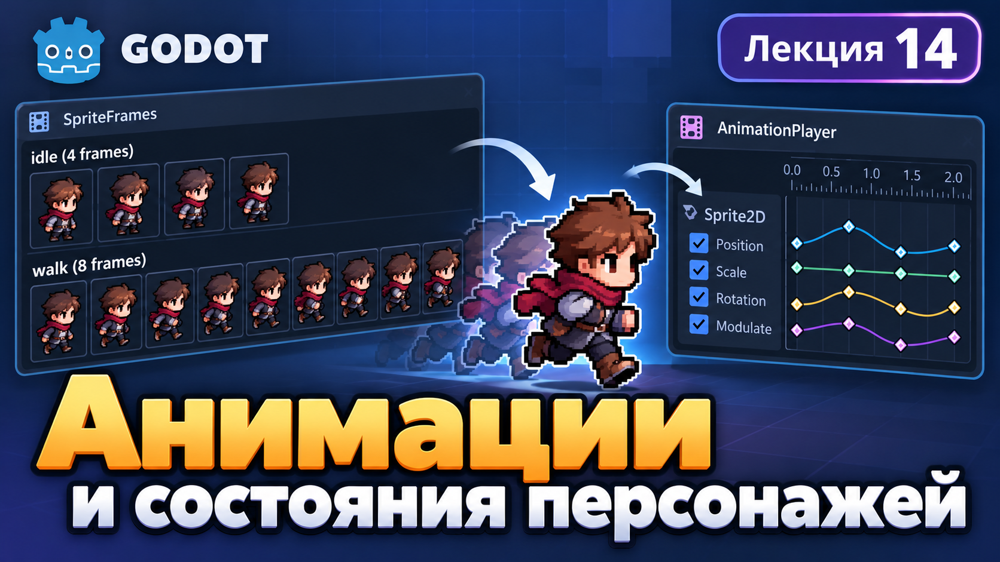
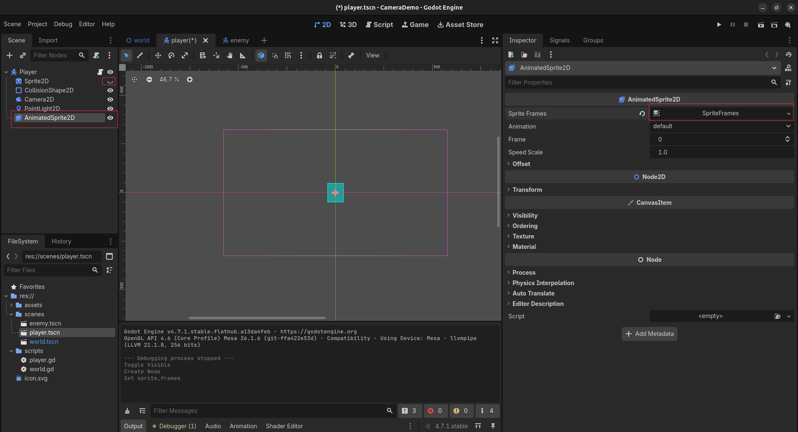
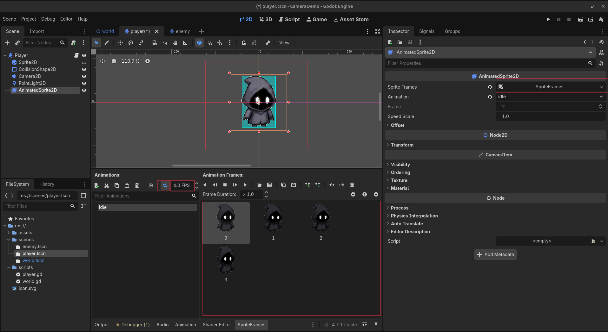
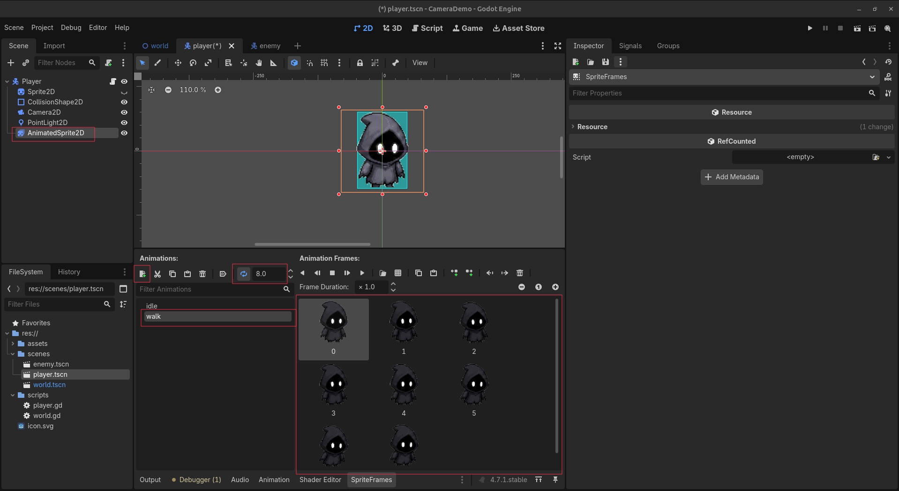
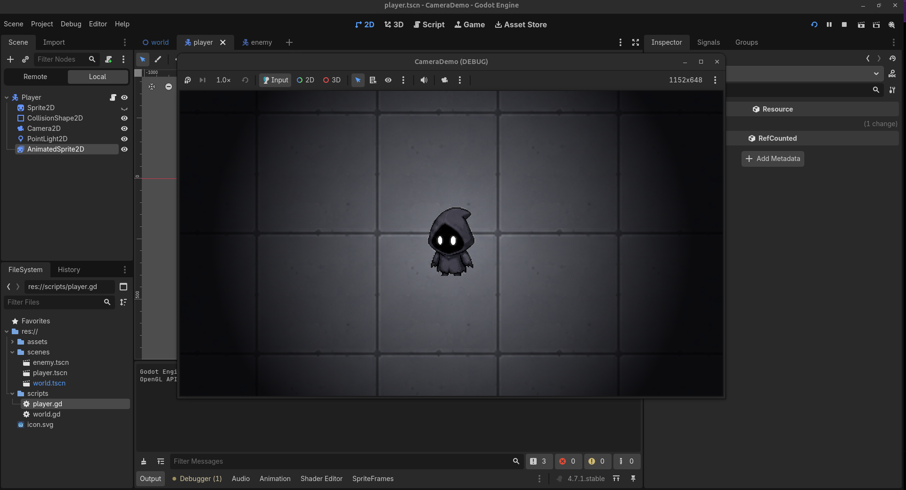
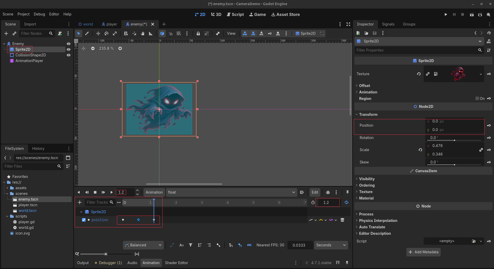
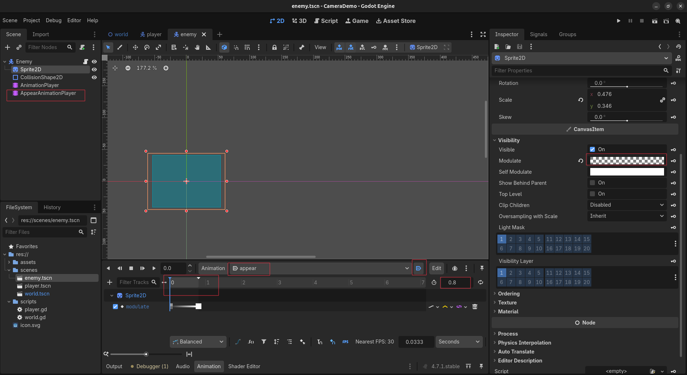
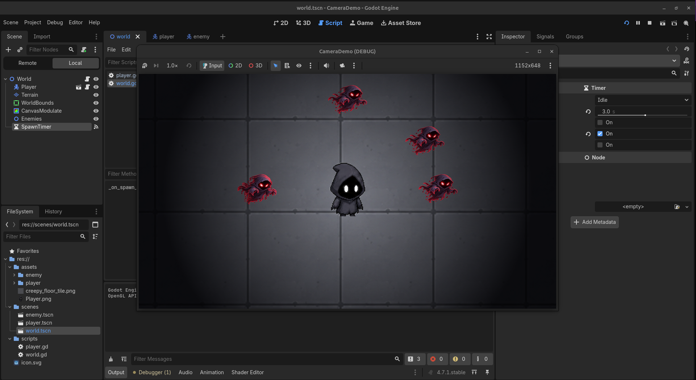

# Лекция 14. Анимации и состояния персонажей



На прошлом занятии мы создали огромный тёмный мир, настроили камеру, добавили освещение и научились создавать противников.

Теперь наша игра становится интереснее, но персонажи всё ещё выглядят неподвижными.

Даже когда игрок перемещается по карте, его изображение не меняется.

На этом занятии мы научимся **создавать анимации и управлять ими с помощью Godot**.

Мы изучим:

- `AnimatedSprite2D` - воспроизведение анимаций из отдельных изображений;
- `SpriteFrames` - создание и настройка покадровых анимаций;
- `FPS` и `Loop` - скорость и повторение анимаций;
- `idle` и `walk` - основные состояния персонажа;
- переключение анимаций через GDScript;
- `AnimationPlayer` - анимацию свойств игровых объектов;
- ключевые кадры и создание плавных переходов.

Продолжим развивать нашу игру **«Кто скрывается в темноте?»**.

Каждый новый инструмент будем сразу применять на практике.

---

## Подготавливаем персонажа к анимации

Для создания анимаций в Godot существует специальный узел - `AnimatedSprite2D`.

В отличие от обычного `Sprite2D`, он позволяет последовательно отображать несколько изображений, создавая иллюзию движения.

### Добавляем изображения

Для работы будем использовать подготовленный набор изображений персонажа.

Добавьте файлы в проект:

```text
assets/
└── player/
    ├── idle_00.png
    ├── idle_01.png
    ├── idle_02.png
    ├── idle_03.png
    ├── walk_00.png
    ├── walk_01.png
    ├── walk_02.png
    ├── walk_03.png
    ├── walk_04.png
    ├── walk_05.png
    ├── walk_06.png
    └── walk_07.png
```

Изображения разделены на две группы:

- `idle` - кадры персонажа в состоянии покоя;
- `walk` - кадры движения персонажа.

Каждое изображение представляет собой отдельный кадр будущей анимации.

### Добавляем AnimatedSprite2D

Откройте сцену:

`scenes/player.tscn`

Добавьте к корневому узлу `Player` новый дочерний узел `AnimatedSprite2D`.

Пока не удаляйте старый `Sprite2D`, а просто отключите его видимость.

Структура сцены:

```text
Player (CharacterBody2D)
├── Sprite2D (скрыт)
├── AnimatedSprite2D
├── CollisionShape2D
├── Camera2D
└── PointLight2D
```

Выберите `AnimatedSprite2D`.

В панели `Inspector` найдите свойство `Sprite Frames` и создайте ресурс:

`New SpriteFrames`

Затем откройте его для редактирования через `Edit`.



Теперь мы можем создавать анимации персонажа.

---

## Создаём первую анимацию - Idle

Начнём с самого простого состояния персонажа - **`idle`**.

Это анимация, которая воспроизводится, когда игрок не нажимает клавиши движения.

### Добавляем кадры

Выберите `AnimatedSprite2D` и откройте вкладку `SpriteFrames` в нижней части редактора.

В списке `Animations` найдите стандартную анимацию `default`.

Переименуйте её в:

`idle`

Теперь нажмите **Add Frames from File** и добавьте четыре изображения:

```text
idle_00.png
idle_01.png
idle_02.png
idle_03.png
```

Убедитесь, что кадры расположены в правильном порядке.

### Настраиваем скорость анимации

Установите следующие параметры:

```text
Animation: idle
FPS: 4
Loop: On
```

**FPS (Frames Per Second)** - количество кадров, которое воспроизводится за одну секунду.

В нашей анимации четыре кадра.

При скорости `4 FPS` каждый кадр отображается `0.25` секунды, а вся последовательность занимает одну секунду.

Параметр `Loop` позволяет повторять анимацию бесконечно.



### Проверяем результат

Нажмите кнопку воспроизведения в редакторе `SpriteFrames`.

Попробуйте изменить скорость анимации:

| FPS | Результат          |
| --- | ------------------ |
| `2` | Медленная анимация |
| `4` | Спокойная анимация |
| `8` | Быстрая анимация   |

После проверки верните значение `4 FPS`.

Теперь персонаж может воспроизводить анимацию покоя.

---

## Создаём анимацию движения - Walk

Следующим шагом создадим вторую анимацию - **`walk`**. Она будет воспроизводиться, когда персонаж перемещается по игровому миру.

### Добавляем новую анимацию

Выберите `AnimatedSprite2D` и откройте редактор `SpriteFrames`. В разделе `Animations` нажмите кнопку добавления новой анимации.

Назовите её:

`walk`

Теперь у нас есть две анимации:

```text
Animations
├── idle
└── walk
```

### Добавляем кадры движения

Выберите `walk` и добавьте восемь изображений:

```text
walk_00.png
walk_01.png
walk_02.png
walk_03.png
walk_04.png
walk_05.png
walk_06.png
walk_07.png
```

Настройте параметры:

```text
Animation: walk
FPS: 8
Loop: On
```

Теперь сравним наши анимации:

| Анимация | Количество кадров | FPS |
| -------- | ----------------: | --: |
| `idle`   |                 4 |   4 |
| `walk`   |                 8 |   8 |



### Проверяем результат

Запустите воспроизведение `walk` в редакторе `SpriteFrames`. Затем переключитесь на `idle`. Обратите внимание, что каждая анимация хранит собственные кадры, скорость и настройки повторения. Однако пока наш персонаж не умеет самостоятельно выбирать нужную анимацию. Для этого воспользуемся GDScript.

---

## Управляем анимациями через GDScript

Теперь научим персонажа автоматически переключаться между двумя состояниями:

- **Idle** - персонаж стоит на месте.
- **Walk** - персонаж перемещается.

Для этого нам понадобится небольшое дополнение к существующему скрипту движения.

### Получаем доступ к AnimatedSprite2D

Откройте:

`scripts/player.gd`

После константы `SPEED` добавьте переменную:

```gdscript
@onready var animated_sprite = $AnimatedSprite2D
```

С помощью `$AnimatedSprite2D` мы получаем доступ к дочернему узлу персонажа.

Аннотация `@onready` позволяет получить этот узел после его появления в дереве сцены.

Теперь через переменную `animated_sprite` можно управлять анимациями.

### Определяем состояние персонажа

В нашем скрипте уже существует переменная `direction`, которая определяет направление движения.

Если игрок не нажимает клавиши, её значение равно:

```gdscript
Vector2.ZERO
```

Это вектор `(0, 0)`, который означает отсутствие направления движения.

Используем это значение, чтобы определить нужную анимацию:

```gdscript
if direction == Vector2.ZERO:
    animated_sprite.play("idle")
else:
    animated_sprite.play("walk")
```

Метод `play()` запускает анимацию по её названию.

Получается простая логика:

1. Если персонаж не двигается - воспроизводим `idle`.
2. Если персонаж двигается - воспроизводим `walk`.

### Обновляем скрипт Player

Теперь наш скрипт выглядит следующим образом:

```gdscript
extends CharacterBody2D

const SPEED = 600.0

@onready var animated_sprite = $AnimatedSprite2D


func _physics_process(_delta):
    var direction = Input.get_vector(
        "move_left",
        "move_right",
        "move_up",
        "move_down"
    )

    velocity = direction * SPEED

    move_and_slide()

    if direction == Vector2.ZERO:
        animated_sprite.play("idle")
    else:
        animated_sprite.play("walk")
```


Обратите внимание: мы не изменяли систему движения персонажа.

Мы только добавили управление анимациями в зависимости от его состояния.

### Проверяем результат

Откройте сцену `Player` и убедитесь, что `AnimatedSprite2D` отображается, а старый `Sprite2D` скрыт.

Запустите игру.

Проверьте:

| Действие        | Анимация |
| --------------- | -------- |
| Персонаж стоит  | `idle`   |
| Движение вверх  | `walk`   |
| Движение вниз   | `walk`   |
| Движение влево  | `walk`   |
| Движение вправо | `walk`   |
| Остановка       | `idle`   |

Если всё работает правильно, удалите старый узел `Sprite2D` из сцены `Player`.

Теперь структура персонажа выглядит так:

```text
Player (CharacterBody2D)
├── AnimatedSprite2D
├── CollisionShape2D
├── Camera2D
└── PointLight2D
```

Теперь персонаж не стоит на месте без анимации, а корректно переключает свои состояния между `idle` и `walk` в зависимости от движения.

---

## Отражаем персонажа при движении

Сейчас наш персонаж использует две анимации:

- `idle` - когда стоит на месте;
- `walk` - когда перемещается.

Однако при движении влево и вправо изображение персонажа не меняет направление.

Исправим это с помощью свойства **`flip_h`**.

### Что такое flip_h?

Свойство `flip_h` позволяет зеркально отражать изображение по горизонтали.

```gdscript
animated_sprite.flip_h = true
```

Изображение отражается.

```gdscript
animated_sprite.flip_h = false
```

Изображение возвращается в исходное положение. Это удобно, когда мы хотим использовать одну анимацию для движения влево и вправо, не создавая дополнительные кадры.

### Добавляем отражение персонажа

Откройте скрипт:

`scripts/player.gd`

После `move_and_slide()` добавьте условие:

```gdscript
if direction.x != 0:
    animated_sprite.flip_h = direction.x < 0
```

Разберём его:

- `direction.x != 0` - проверяем, движется ли персонаж по горизонтали.
- `direction.x < 0` - проверяем, направлено ли движение влево.
- `flip_h` - отражает изображение, если условие истинно.

При движении вправо отражение отключается автоматически.

### Обновляем скрипт Player

Теперь наш код выглядит следующим образом:

```gdscript
extends CharacterBody2D

const SPEED = 600.0

@onready var animated_sprite = $AnimatedSprite2D


func _physics_process(_delta):
    var direction = Input.get_vector(
        "move_left",
        "move_right",
        "move_up",
        "move_down"
    )

    velocity = direction * SPEED

    move_and_slide()

    if direction.x != 0:
        animated_sprite.flip_h = direction.x < 0

    if direction == Vector2.ZERO:
        animated_sprite.play("idle")
    else:
        animated_sprite.play("walk")
```



### Проверяем результат

Запустите игру и проверьте:

1. Нажмите `A` - изображение персонажа отражается.
2. Нажмите `D` - изображение возвращается в исходное положение.
3. Нажмите `W` или `S` - продолжает воспроизводиться анимация `walk`.
4. Отпустите клавиши - включается `idle`.

**Обратите внимание:** `flip_h` зеркально отражает изображение, но не разворачивает персонажа в профиль. Если спрайт почти симметричный, изменение может быть малозаметным. Теперь мы умеем управлять анимациями и отражением персонажа через GDScript.

---

## Анимируем противника с помощью AnimationPlayer

Мы уже научились создавать покадровые анимации с помощью `AnimatedSprite2D`. Теперь познакомимся с другим инструментом - **AnimationPlayer**.

Он позволяет анимировать различные свойства объектов:

- `Position` - положение;
- `Scale` - размер;
- `Rotation` - поворот;
- `Modulate` - цвет и прозрачность.

Для примера оживим нашего призрака. Он будет плавно парить в воздухе и постепенно появляться из темноты.

### Добавляем AnimationPlayer

Откройте сцену `scenes/enemy.tscn`.

Добавьте к корневому узлу `Enemy` новый узел `AnimationPlayer`.

```text
Enemy (CharacterBody2D)
├── Sprite2D
├── CollisionShape2D
└── AnimationPlayer
```

Выберите `AnimationPlayer` и откройте вкладку `Animation` в нижней части редактора.

Создайте новую анимацию:

```text
Animation: float
Length: 1.2
Loop: On
```

Анимация `float` будет отвечать за плавное парение призрака.

### Создаём ключевые кадры

В `AnimationPlayer` движение создаётся с помощью **ключевых кадров (Keyframes)**.Ключевой кадр сохраняет значение свойства объекта в определённый момент времени. Godot автоматически вычисляет промежуточные значения между ключевыми кадрами, создавая плавную анимацию. Выберите `Sprite2D` и найдите в `Inspector` свойство:

`Transform → Position`

Создадим три ключевых кадра:

| Время | Position X | Position Y |
| ----- | ---------: | ---------: |
| `0.0` |          0 |          0 |
| `0.6` |          0 |        -12 |
| `1.2` |          0 |          0 |

Для каждого кадра:

1. Установите нужное время на шкале анимации.
2. Измените значение `Position`.
3. Нажмите значок ключа рядом со свойством.
4. Повторите действия для остальных кадров.

После добавления первого ключа Godot создаст дорожку `Sprite2D → position`.



Теперь запустите воспроизведение анимации. Призрак должен плавно подниматься и опускаться.

**Обратите внимание:** мы изменяем положение `Sprite2D`, а не корневого `CharacterBody2D`. Поэтому физическая коллизия противника остаётся на месте.

### Включаем автоматическое воспроизведение

Чтобы анимация запускалась при появлении противника, включите **Autoplay on Load**. Для этого выберите анимацию `float` и нажмите кнопку автоматического воспроизведения рядом с её названием в нижней панели `Animation`. Убедитесь, что `Loop` также включён. Теперь каждый созданный противник будет автоматически воспроизводить анимацию парения.

---

## Создаём эффект появления призрака

Сейчас призраки возникают на карте мгновенно. Сделаем появление более интересным: противник будет постепенно становиться видимым. Для этого используем свойство `Modulate`, которое позволяет изменять цвет и прозрачность изображения.

### Добавляем второй AnimationPlayer

Откройте сцену `Enemy` и добавьте ещё один узел `AnimationPlayer`.

Назовите его `AppearAnimationPlayer`.

```text
Enemy (CharacterBody2D)
├── Sprite2D
├── CollisionShape2D
├── AnimationPlayer
└── AppearAnimationPlayer
```

Зачем использовать два узла? Наш первый `AnimationPlayer` постоянно воспроизводит `float`. Второй позволит одновременно запускать отдельную анимацию появления. Каждый из них будет изменять разные свойства `Sprite2D`:

- `AnimationPlayer` - положение;
- `AppearAnimationPlayer` - прозрачность.

### Создаём анимацию appear

Выберите `AppearAnimationPlayer` и создайте новую анимацию:

```text
Animation: appear
Length: 0.8
Loop: Off
```

Эта анимация должна воспроизводиться только один раз при появлении противника.

### Анимируем прозрачность

Выберите узел `Sprite2D`.

В `Inspector` откройте:

`Visibility → Modulate`

С помощью параметра `Alpha` можно управлять прозрачностью изображения:

- `Alpha = 0` - изображение полностью прозрачное;
- `Alpha = 255` - изображение полностью непрозрачное.

Создадим два ключевых кадра:

| Время | Alpha | Результат               |
| ----- | ----: | ----------------------- |
| `0.0` |     0 | Призрак невидим         |
| `0.8` |   255 | Призрак полностью видим |

Для первого кадра установите время `0.0`, измените прозрачность и нажмите значок ключа возле `Modulate`. Затем перейдите к `0.8` секунды, установите полную непрозрачность и добавьте второй ключевой кадр.

Теперь на временной шкале появится дорожка:

`Sprite2D → modulate`



### Настраиваем автоматический запуск

Выберите анимацию `appear` и включите **Autoplay on Load**.

Проверьте настройки обоих узлов:

| Узел                    | Анимация | Autoplay | Loop |
| ----------------------- | -------- | -------- | ---- |
| `AnimationPlayer`       | `float`  | On       | On   |
| `AppearAnimationPlayer` | `appear` | On       | Off  |

Сохраните сцену `Enemy`.

### Проверяем результат

Откройте `world.tscn` и запустите игру.Дождитесь появления нескольких призраков.

Теперь каждый противник должен:

1. Появляться в случайном месте игрового мира.
2. Постепенно становиться видимым.
3. Плавно подниматься и опускаться.
4. Продолжать парить после завершения анимации `appear`.

Обратите внимание, что для воспроизведения этих анимаций нам не пришлось добавлять новый GDScript-код.

### Чем отличаются AnimatedSprite2D и AnimationPlayer?

Мы познакомились с двумя инструментами анимации Godot.

| AnimatedSprite2D                          | AnimationPlayer                               |
| ----------------------------------------- | --------------------------------------------- |
| Использует последовательность изображений | Изменяет свойства объектов                    |
| Работает с ресурсом `SpriteFrames`        | Работает с ключевыми кадрами                  |
| Подходит для анимаций ходьбы и действий   | Подходит для перемещения, поворота и эффектов |
| Управляет воспроизведением кадров         | Позволяет анимировать разные свойства узлов   |

Эти инструменты можно использовать вместе. **AnimatedSprite2D** помогает оживлять персонажей с помощью готовых кадров, а **AnimationPlayer** позволяет создавать дополнительные визуальные эффекты непосредственно в редакторе Godot.

Теперь наши призраки не просто появляются на карте - они постепенно возникают из темноты и плавно парят в воздухе.

---

## Проверяем анимации в игровом мире

Теперь наш персонаж умеет переключаться между анимациями `idle` и `walk`, а призраки плавно появляются и парят в воздухе.

Осталось проверить, как все анимации работают вместе в нашей игре.

### Делаем появление призраков заметнее

Ранее противники появлялись далеко от игрока. Из-за этого анимация `appear` успевала завершиться ещё до того, как персонаж замечал призрака.

Чтобы увидеть эффект появления, изменим расстояние создания противников.

Откройте `scripts/world.gd` и найдите массив возможных позиций:

```gdscript
var positions = [
    Vector2(250, 0),
    Vector2(-250, 0),
    Vector2(0, 250),
    Vector2(0, -250)
]
```

Теперь призраки будут появляться ближе к персонажу.

Затем откройте `enemy.tscn` и выберите `AppearAnimationPlayer`.

Увеличьте длительность анимации:

```text
Animation: appear
Length: 1.5
Loop: Off
```

Переместите последний ключевой кадр на `1.5` секунды.

Теперь призрак будет появляться медленнее, и игроку будет проще заметить этот эффект.

### Проверяем результат

Откройте `world.tscn` и запустите игру.

Проверьте:

1. Когда персонаж стоит, воспроизводится `idle`.
2. При движении включается `walk`.
3. При движении влево изображение персонажа отражается.
4. Призраки автоматически появляются возле игрока.
5. Анимация `appear` постепенно делает призраков видимыми.
6. Анимация `float` непрерывно воспроизводится после появления.
7. Камера и освещение продолжают работать.



### Что мы получили?

Теперь наш игровой мир стал значительно живее.

Персонаж реагирует на управление не только перемещением, но и сменой анимации.

Призраки больше не выглядят неподвижными изображениями: они постепенно появляются и плавно парят в воздухе.

При этом мы использовали два разных инструмента:

- `AnimatedSprite2D` - для покадровой анимации персонажа.
- `AnimationPlayer` - для анимации положения и прозрачности призраков.

Далее закрепим полученные знания на самостоятельной практике и создадим новые визуальные эффекты.

---

## Практика - «Оживляем игровой мир»

Наш персонаж уже умеет ходить, а призраки плавно появляются и парят в воздухе. Но игровой мир можно сделать ещё интереснее!

Сегодня вы самостоятельно создадите два новых эффекта:

- **Живую тень**, которая меняется во время движения призрака.
- **Пульсирующий свет**, который создаёт атмосферу загадочного мира.

Для выполнения заданий используйте `AnimationPlayer` и ключевые кадры.

### Задание 1. Живая тень призрака

Когда призрак поднимается вверх, его тень должна становиться меньше. Когда опускается - увеличиваться.

**Что нужно сделать:**

1. Откройте сцену `enemy.tscn`.
2. Добавьте новый `Sprite2D` с названием `Shadow`.
3. Используйте изображение `ghost_shadow.png`.
4. Разместите тень под призраком так, чтобы она отображалась позади него.
5. Откройте существующую анимацию `float`.
6. Добавьте дорожку для изменения `Shadow → Scale`.
7. Создайте три ключевых кадра.

**Подсказка:**

| Время | Размер тени |
| ----- | ----------- |
| `0.0` | Обычный     |
| `0.6` | Уменьшенный |
| `1.2` | Обычный     |

Размер тени подберите самостоятельно.

**Важно:** тень должна оставаться на месте, пока призрак поднимается и опускается.

**Результат:** призрак парит в воздухе, а его тень меняет размер в зависимости от высоты.

---

### Задание 2. Магический свет

Сейчас фонарь нашего персонажа светит с постоянной яркостью. Сделайте так, чтобы свет плавно усиливался и ослабевал!

**Что нужно сделать:**

1. Откройте сцену `player.tscn`.
2. Добавьте узел `AnimationPlayer`.
3. Создайте анимацию `light_pulse`.
4. Установите длительность анимации `2` секунды.
5. Найдите свойство `Energy` у `PointLight2D`.
6. Добавьте три ключевых кадра, изменяющих яркость света.
7. Включите `Loop` и `Autoplay`.

**Подсказка:**

| Время | Energy |
| ----- | ------ |
| `0.0` | 1.5    |
| `1.0` | 1.2    |
| `2.0` | 1.5    |

Попробуйте изменить значения, чтобы получить наиболее интересный эффект.

**Результат:** вокруг персонажа плавно пульсирует свет, создавая атмосферу таинственного мира.

---

### Дополнительное задание - «Собственный эффект»

Если вы закончили раньше остальных, придумайте собственную анимацию!

Например:

- Призрак периодически меняет цвет.
- Противник слегка поворачивается из стороны в сторону.
- Свет персонажа становится ярче, а затем возвращается к обычному состоянию.

**Условия:**

1. Использовать `AnimationPlayer`.
2. Создать минимум три ключевых кадра.
3. Настроить автоматическое воспроизведение.
4. Проверить результат в игре.

---

## Домашнее задание - «Оживляем свой игровой мир»

Продолжаем работу над игрой **«Кто скрывается в темноте?»**, которую вы начали в домашнем задании к лекции 13.

Ваша задача - добавить анимации персонажу и противникам, а также создать новые анимированные объекты.

### Подготовка

Самостоятельно найдите изображения и наборы анимаций для своей игры.

**Полезные ресурсы:**

- [itch.io - бесплатные игровые ассеты](https://itch.io/game-assets/free) - персонажи, противники, предметы и готовые наборы анимаций.
- [Kenney](https://kenney.nl/assets) - бесплатные наборы графики для игр.
- [OpenGameArt](https://opengameart.org/) - изображения, спрайты и анимации для 2D-игр.

При поиске обращайте внимание на наборы с несколькими кадрами анимации (`Sprite Sheet`, `Spritesheet`).

Желательно подобрать персонажа с анимациями `idle` и `walk`.

**Важно:** используйте графику, подходящую для игры с видом сверху, и старайтесь придерживаться единого визуального стиля.

### Задание 1. Анимация персонажа

Добавьте анимации главному герою вашей игры.

1. Настройте `AnimatedSprite2D` и ресурс `SpriteFrames`.
2. Создайте анимации `idle` и `walk`.
3. Реализуйте переключение анимаций при движении.
4. Настройте отражение персонажа при движении влево через `flip_h`.

**Результат:** персонаж воспроизводит анимацию ожидания, когда стоит на месте, и анимацию ходьбы во время движения.

### Задание 2. Анимация противников

Оживите противников из предыдущего домашнего задания.

С помощью `AnimationPlayer` создайте две анимации:

- `float` - противник плавно поднимается и опускается.
- `appear` - противник постепенно появляется, изменяя прозрачность.

Настройте автоматическое воспроизведение анимаций.

**Результат:** противники плавно появляются в игровом мире и продолжают двигаться вверх и вниз.

### Задание 3. Магические артефакты

Добавьте в игровой мир новые загадочные предметы.

Это могут быть кристаллы, магические шары, древние символы или любые другие объекты.

1. Создайте отдельную сцену `artifact.tscn`.
2. Добавьте изображение выбранного предмета.
3. Создайте анимацию парения с помощью `AnimationPlayer`.
4. Добавьте изменение размера предмета во время анимации.
5. Настройте бесконечное воспроизведение.
6. Разместите минимум **3 артефакта** в разных местах игрового мира.

**Результат:** на карте находятся три анимированных артефакта, которые плавно парят и изменяют свой размер.

### Дополнительное задание

Добавьте артефактам ещё один визуальный эффект на выбор:

- Плавное появление.
- Изменение цвета.
- Вращение.
- Пульсацию яркости.

Используйте `AnimationPlayer` и ключевые кадры.

### Требования к результату

В вашей игре должны быть:

- Персонаж с анимациями `idle` и `walk`.
- Переключение анимаций при движении.
- Анимированные противники.
- Плавное появление противников.
- Минимум три магических артефакта.
- Анимация парения и изменения размера артефактов.
- Автоматическое воспроизведение всех созданных анимаций.

**Сохраните проект!** В следующей лекции мы продолжим развивать эту игру и научимся взаимодействовать с предметами игрового мира.

---

## Итоги

На этой лекции мы научились создавать анимации персонажей и игровых объектов в Godot.

**Что мы изучили:**

- `AnimatedSprite2D` и `SpriteFrames` - создание покадровых анимаций.
- `idle` и `walk` - анимации ожидания и движения персонажа.
- `flip_h` - отражение персонажа при движении влево.
- `AnimationPlayer` - анимация свойств объектов.
- `Keyframes` - создание плавных переходов между значениями.
- `Position`, `Scale`, `Modulate` - изменение положения, размера и прозрачности.
- `Loop` и `Autoplay` - повторение и автоматический запуск анимаций.

**Что мы сделали:**

- Оживили главного персонажа.
- Добавили призракам анимацию парения.
- Реализовали плавное появление противников.
- На практике закрепили работу с анимациями тени и освещения.

Теперь наш игровой мир стал динамичнее: персонаж реагирует на движение, а противники получили собственные визуальные эффекты.

**В следующей лекции** научимся добавлять собираемые предметы и опасные препятствия, а также обрабатывать взаимодействие игрока с ними.
